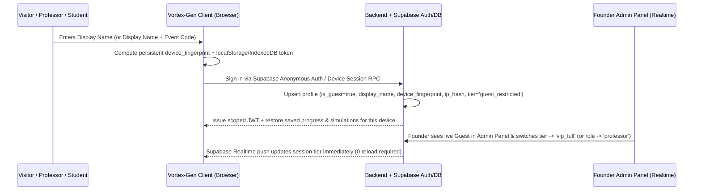

# Vortex-Gen — Design & Architecture Specification

**Status:** Planning Phase (no application code modified)  
**Target Repository:** `c:/Users/youssef/.gemini/antigravity/scratch/Vortex-Gen`  
**Stack Inspected:** React 19.2.4, Vite 8.0.1, Tailwind CSS 4.2.2, Three.js 0.183.2 (`@react-three/fiber` 9.6.1, `@react-three/drei` 10.7.7), Recharts 3.8.1, Framer Motion 12.40.0, Zustand 5.0.0, Supabase JS 2.108.2, Express 5.2.1 (`backend/server.js`), Python NeuralFoil IPC daemon (`backend/run_nf.py`).

---

## 1. Current Codebase Audit

### 1.1 Architectural State: Two Parallel Trees in One Repository
The repository contains an incomplete migration ([`frontend/MIGRATION_COMPLETE.md`](file:///c:/Users/youssef/.gemini/antigravity/scratch/Vortex-Gen/frontend/MIGRATION_COMPLETE.md)) that left two competing application trees on disk:

1. **Mounted JSX Application (Active):**
   - Entrypoint: [`frontend/index.html:18`](file:///c:/Users/youssef/.gemini/antigravity/scratch/Vortex-Gen/frontend/index.html#L18) loads [`frontend/src/main.jsx`](file:///c:/Users/youssef/.gemini/antigravity/scratch/Vortex-Gen/frontend/src/main.jsx) $\rightarrow$ [`frontend/src/App.jsx`](file:///c:/Users/youssef/.gemini/antigravity/scratch/Vortex-Gen/frontend/src/App.jsx).
   - State: React Contexts in [`AppContext.jsx`](file:///c:/Users/youssef/.gemini/antigravity/scratch/Vortex-Gen/frontend/src/context/AppContext.jsx), [`AcademyContext.jsx`](file:///c:/Users/youssef/.gemini/antigravity/scratch/Vortex-Gen/frontend/src/context/AcademyContext.jsx), and [`TenantContext.jsx`](file:///c:/Users/youssef/.gemini/antigravity/scratch/Vortex-Gen/frontend/src/context/TenantContext.jsx).
   - Stylesheet: [`frontend/src/index.css`](file:///c:/Users/youssef/.gemini/antigravity/scratch/Vortex-Gen/frontend/src/index.css) (971 lines).
2. **Unmounted TypeScript Application (Dead Duplicate Tree):**
   - Entrypoint: [`frontend/src/main.tsx`](file:///c:/Users/youssef/.gemini/antigravity/scratch/Vortex-Gen/frontend/src/main.tsx) $\rightarrow$ [`frontend/src/App.tsx`](file:///c:/Users/youssef/.gemini/antigravity/scratch/Vortex-Gen/frontend/src/App.tsx) (never referenced by `index.html`).
   - State: Zustand stores in [`frontend/src/store/`](file:///c:/Users/youssef/.gemini/antigravity/scratch/Vortex-Gen/frontend/src/store/index.ts) (`authStore.ts`, `settingsStore.ts`, `simulationStore.ts`, `appContextShim.ts`).
   - Feature duplicates: [`src/features/lab/`](file:///c:/Users/youssef/.gemini/antigravity/scratch/Vortex-Gen/frontend/src/features/lab/pages/DashboardPage.tsx), [`src/features/academy/`](file:///c:/Users/youssef/.gemini/antigravity/scratch/Vortex-Gen/frontend/src/features/academy/pages/ExplorerPage.tsx), [`src/features/auth/`](file:///c:/Users/youssef/.gemini/antigravity/scratch/Vortex-Gen/frontend/src/features/auth/pages/LoginPage.tsx), [`src/features/landing/`](file:///c:/Users/youssef/.gemini/antigravity/scratch/Vortex-Gen/frontend/src/features/landing/pages/LandingPage.tsx), [`src/features/pricing/`](file:///c:/Users/youssef/.gemini/antigravity/scratch/Vortex-Gen/frontend/src/features/pricing/pages/PricingPage.tsx), [`src/features/profile/`](file:///c:/Users/youssef/.gemini/antigravity/scratch/Vortex-Gen/frontend/src/features/profile/pages/ProfilePage.tsx), [`src/features/settings/`](file:///c:/Users/youssef/.gemini/antigravity/scratch/Vortex-Gen/frontend/src/features/settings/pages/SettingsPage.tsx), and [`src/styles/index.css`](file:///c:/Users/youssef/.gemini/antigravity/scratch/Vortex-Gen/frontend/src/styles/index.css) (967 lines).
3. **Cross-Imported Dual Supabase Clients:**
   - [`frontend/src/services/supabaseClient.js`](file:///c:/Users/youssef/.gemini/antigravity/scratch/Vortex-Gen/frontend/src/services/supabaseClient.js) and [`frontend/src/lib/supabaseClient.ts`](file:///c:/Users/youssef/.gemini/antigravity/scratch/Vortex-Gen/frontend/src/lib/supabaseClient.ts) both instantiate `createClient(...)`.
   - Active JSX pages [`Settings.jsx:4`](file:///c:/Users/youssef/.gemini/antigravity/scratch/Vortex-Gen/frontend/src/pages/Settings.jsx#L4) and [`Admin.jsx:3`](file:///c:/Users/youssef/.gemini/antigravity/scratch/Vortex-Gen/frontend/src/pages/Admin.jsx#L3) import from `../lib/supabaseClient`, while [`AppContext.jsx:2`](file:///c:/Users/youssef/.gemini/antigravity/scratch/Vortex-Gen/frontend/src/context/AppContext.jsx#L2) and [`Home.jsx:10`](file:///c:/Users/youssef/.gemini/antigravity/scratch/Vortex-Gen/frontend/src/pages/Home.jsx#L10) import from `../services/supabaseClient`, running two concurrent GoTrue auth clients in the same browser tab.

---

### 1.2 Current Route & Navigation Audit ([`frontend/src/App.jsx`](file:///c:/Users/youssef/.gemini/antigravity/scratch/Vortex-Gen/frontend/src/App.jsx))

| Route Path | Mounted Layout & Component | Current Functional Status |
| :--- | :--- | :--- |
| `/` | [`LandingPage.jsx`](file:///c:/Users/youssef/.gemini/antigravity/scratch/Vortex-Gen/frontend/src/pages/LandingPage.jsx) | Works; contains unrequested marketing testimonials and decorative gradient blobs. |
| `/pitch` | [`Pitch.jsx`](file:///c:/Users/youssef/.gemini/antigravity/scratch/Vortex-Gen/frontend/src/pages/Pitch.jsx) | Investor pitch deck with two separate `<Canvas>` instances; not linked in main navigation. |
| `/login`, `/signup` | [`Login.jsx`](file:///c:/Users/youssef/.gemini/antigravity/scratch/Vortex-Gen/frontend/src/pages/Login.jsx), [`Signup.jsx`](file:///c:/Users/youssef/.gemini/antigravity/scratch/Vortex-Gen/frontend/src/pages/Signup.jsx) | Left hero panel in [`Login.jsx:243-253`](file:///c:/Users/youssef/.gemini/antigravity/scratch/Vortex-Gen/frontend/src/pages/Login.jsx#L243-L253) uses `'@media (min-width: 1024px)'` inside an inline React `style` object (`display: 'none'`), so it never renders on any viewport. |
| `/explore` | [`ExplorerLayout.jsx`](file:///c:/Users/youssef/.gemini/antigravity/scratch/Vortex-Gen/frontend/src/layouts/ExplorerLayout.jsx) $\rightarrow$ [`Explorer.jsx`](file:///c:/Users/youssef/.gemini/antigravity/scratch/Vortex-Gen/frontend/src/pages/Explorer.jsx) | 3D aircraft viewer ([`AircraftViewer3D.jsx`](file:///c:/Users/youssef/.gemini/antigravity/scratch/Vortex-Gen/frontend/src/components/AircraftViewer3D.jsx)) mutates cached glTF scene position on every mount (`lines 74–97`) and ignores the `hoveredZone` prop (`line 67`). |
| `/explore/fuselage`, `wings`, `tail`, `airfoil`, `engines` | [`pages/explore/*Section.jsx`](file:///c:/Users/youssef/.gemini/antigravity/scratch/Vortex-Gen/frontend/src/pages/explore/FuselageSection.jsx) | Separate static/2D SVG theory pages. [`EnginesSection.jsx`](file:///c:/Users/youssef/.gemini/antigravity/scratch/Vortex-Gen/frontend/src/pages/explore/EnginesSection.jsx) uses a flat 2D SVG while the 3D jet engine model (`public/models/jet_engine/scene.gltf`) sits unused. |
| `/lab` | [`LabLayout.jsx`](file:///c:/Users/youssef/.gemini/antigravity/scratch/Vortex-Gen/frontend/src/layouts/LabLayout.jsx) $\rightarrow$ [`LabHub.jsx`](file:///c:/Users/youssef/.gemini/antigravity/scratch/Vortex-Gen/frontend/src/pages/lab/LabHub.jsx) | Unmounts `<Outlet />` for 600ms on every route change (`LabLayout.jsx:25-29`). |
| `/lab/wings`, `tail`, `fuselage`, `engines` | [`WingsLab.jsx`](file:///c:/Users/youssef/.gemini/antigravity/scratch/Vortex-Gen/frontend/src/pages/lab/WingsLab.jsx), [`TailLab.jsx`](file:///c:/Users/youssef/.gemini/antigravity/scratch/Vortex-Gen/frontend/src/pages/lab/TailLab.jsx), [`FuselageLab.jsx`](file:///c:/Users/youssef/.gemini/antigravity/scratch/Vortex-Gen/frontend/src/pages/lab/FuselageLab.jsx), [`EnginesLab.jsx`](file:///c:/Users/youssef/.gemini/antigravity/scratch/Vortex-Gen/frontend/src/pages/lab/EnginesLab.jsx) | Fragmented 2D/3D labs with physics bugs (Section 1.3) and undefined `useAcademy()` context calls (`TailLab.jsx:202`, `EnginesLab.jsx:361`). |
| `/principles-of-flight/*` | [`FlightLabLayout.jsx`](file:///c:/Users/youssef/.gemini/antigravity/scratch/Vortex-Gen/frontend/src/features/flight-lab/pages/FlightLabLayout.jsx) $\rightarrow$ 5 tabs | **Orphaned route:** 5 chapters (`AerodynamicsTab`, `LiftEquationTab`, `HighLiftDevicesTab`, `StabilityTab`, `ControlsTab`) have zero links pointing to them from `/`, `/explore`, or `/lab`. |
| `/lab/airfoil` | [`DashboardLayout.jsx`](file:///c:/Users/youssef/.gemini/antigravity/scratch/Vortex-Gen/frontend/src/layouts/DashboardLayout.jsx) $\rightarrow$ [`Home.jsx`](file:///c:/Users/youssef/.gemini/antigravity/scratch/Vortex-Gen/frontend/src/pages/Home.jsx) | Switches out of `LabLayout` into `DashboardLayout`, losing the lab navigation bar; `TopNavItem` checks `to="/dashboard"` (`DashboardLayout.jsx:43,123`), so the active tab indicator never highlights on `/lab/airfoil`. |
| `/instructor` | Defined **twice** in [`App.jsx:122`](file:///c:/Users/youssef/.gemini/antigravity/scratch/Vortex-Gen/frontend/src/App.jsx#L122) and [`App.jsx:148`](file:///c:/Users/youssef/.gemini/antigravity/scratch/Vortex-Gen/frontend/src/App.jsx#L148) | Second route inside `DashboardLayout` is shadowed and unreachable; [`InstructorDashboard.jsx`](file:///c:/Users/youssef/.gemini/antigravity/scratch/Vortex-Gen/frontend/src/pages/instructor/InstructorDashboard.jsx) queries columns (`first_name`, `last_name`, `academy_id`) missing from [`001_workspace_model.sql`](file:///c:/Users/youssef/.gemini/antigravity/scratch/Vortex-Gen/supabase/migrations/001_workspace_model.sql). |
| `/onboarding`, `/academy-admin` | [`Onboarding.jsx`](file:///c:/Users/youssef/.gemini/antigravity/scratch/Vortex-Gen/frontend/src/pages/Onboarding.jsx), [`AcademyAdmin.jsx`](file:///c:/Users/youssef/.gemini/antigravity/scratch/Vortex-Gen/frontend/src/pages/admin/AcademyAdmin.jsx) | **Unrouted & broken:** Neither page is mounted in `App.jsx`, and both import `{ apiFetch }` from [`apiService.js`](file:///c:/Users/youssef/.gemini/antigravity/scratch/Vortex-Gen/frontend/src/services/apiService.js), which does not export `apiFetch`. |

---

### 1.3 Verified Functional & Physics Bugs

| File & Lines | Defect Description |
| :--- | :--- |
| [`Home.jsx:282-307, 553`](file:///c:/Users/youssef/.gemini/antigravity/scratch/Vortex-Gen/frontend/src/pages/Home.jsx#L553) | `handleShapeClick` calls `setCompareShapeIdGlobal(id)` without destructuring it from `useAppContext()`. Clicking any airfoil in Compare Mode throws `ReferenceError: setCompareShapeIdGlobal is not defined`. |
| [`Home.jsx:451-483`](file:///c:/Users/youssef/.gemini/antigravity/scratch/Vortex-Gen/frontend/src/pages/Home.jsx#L451-L483) | `playAlarm()` creates a new `window.AudioContext()` every 300–700ms during stall and never calls `audioCtx.close()`, exhausting browser Web Audio contexts. |
| [`Home.jsx:115, 153`](file:///c:/Users/youssef/.gemini/antigravity/scratch/Vortex-Gen/frontend/src/pages/Home.jsx#L153) | `iterateNACA4DigitCandidates` sets `p: isDeep ? 0.4 : 4` on symmetric airfoils; `Math.abs(p - 0.4) * 4` adds `+14.4°` to `stallPos` in Fast Tune (`~28.4°` instead of `14°`). |
| [`Home.jsx:485-488, 839, 1251`](file:///c:/Users/youssef/.gemini/antigravity/scratch/Vortex-Gen/frontend/src/pages/Home.jsx#L1251) | Imperial units toggle changes the label from `m/s` to `mph` without converting `windSpeed`, while Reynolds and force equations compute with `windSpeed` as `m/s`. |
| [`PdfReportTemplate.jsx:93, 136`](file:///c:/Users/youssef/.gemini/antigravity/scratch/Vortex-Gen/frontend/src/components/PdfReportTemplate.jsx#L93-L136) | Renders `renderComparisonPage()` when `isCompareMode` is true even if `compareShape` is `undefined`, crashing on `compareShape.name`. |
| [`Export3DModal.jsx:428`](file:///c:/Users/youssef/.gemini/antigravity/scratch/Vortex-Gen/frontend/src/components/Export3DModal.jsx#L428) | Computes wing volume as `chord * 0.12 * span / 1000` (1D thickness instead of 2D cross-section area $\approx 0.082 \times c^2$), underreporting volume by $\sim 70\times$. |
| [`WingsLab.jsx:65-79`](file:///c:/Users/youssef/.gemini/antigravity/scratch/Vortex-Gen/frontend/src/pages/lab/WingsLab.jsx#L65-L79) | `mach` and `sweep` are omitted from `cdi` and `ld` calculations; `criticalMach = 0.75 / Math.cos(sweepRad)` yields values $>1.0$ and is unused. |
| [`TailLab.jsx:210-239, 404, 476`](file:///c:/Users/youssef/.gemini/antigravity/scratch/Vortex-Gen/frontend/src/pages/lab/TailLab.jsx#L210-L239) | `NP_PCT = 38` is hardcoded so Tail Area ($S_t$) and Tail Arm ($L_t$) sliders have zero effect on Neutral Point or Static Margin; positive `pitchAngle` rotates the nose-left SVG clockwise (nose-up when nose-heavy). |
| [`FuselageLab.jsx:59-66, 213-221`](file:///c:/Users/youssef/.gemini/antigravity/scratch/Vortex-Gen/frontend/src/pages/lab/FuselageLab.jsx#L59-L66) | Hardcodes `cabinPsi = 10.92 PSI` at sea level (`0 ft` where `ambientPsi = 14.70 PSI`); clamps atmosphere sidebar at `51,000 ft` while `Stratosphere` starts at `56,000 ft` (`height: 0%`). |
| [`EnginesLab.jsx:154-175`](file:///c:/Users/youssef/.gemini/antigravity/scratch/Vortex-Gen/frontend/src/pages/lab/EnginesLab.jsx#L154-L175) | Above `11 km`, `lapseRate` switches from `6.5` to `0` in `T = T0 - lapseRate * altKm`, resetting stratospheric temperature to `+15°C` (`288.15 K`) and pressure to `101.3 kPa`; `bpr` is omitted from `netThrust`. |

---

### 1.4 Quantified "Anti-AI" UI/UX Violations Across 126 Frontend Source Files

A static scan across all 126 files in `frontend/src/` confirmed the following exact violation counts:

| Violation Category | Occurrences | Primary Offending Files & Line References |
| :--- | :---: | :--- |
| **ALL-CAPS labels (`uppercase` / `text-transform: uppercase`)** | **294** | [`Home.jsx`](file:///c:/Users/youssef/.gemini/antigravity/scratch/Vortex-Gen/frontend/src/pages/Home.jsx) (19), [`ControlsTab.jsx`](file:///c:/Users/youssef/.gemini/antigravity/scratch/Vortex-Gen/frontend/src/features/flight-lab/pages/ControlsTab.jsx) (15), [`TailLab.jsx`](file:///c:/Users/youssef/.gemini/antigravity/scratch/Vortex-Gen/frontend/src/pages/lab/TailLab.jsx) (11), [`EnginesLab.jsx`](file:///c:/Users/youssef/.gemini/antigravity/scratch/Vortex-Gen/frontend/src/pages/lab/EnginesLab.jsx) (11), [`StabilityTab.jsx`](file:///c:/Users/youssef/.gemini/antigravity/scratch/Vortex-Gen/frontend/src/features/flight-lab/pages/StabilityTab.jsx) (9), [`WingsLab.jsx`](file:///c:/Users/youssef/.gemini/antigravity/scratch/Vortex-Gen/frontend/src/pages/lab/WingsLab.jsx) (9), [`FuselageLab.jsx`](file:///c:/Users/youssef/.gemini/antigravity/scratch/Vortex-Gen/frontend/src/pages/lab/FuselageLab.jsx) (9) |
| **Purple / Violet / Fuchsia / Indigo palette tokens** | **239** | [`index.css:22,54`](file:///c:/Users/youssef/.gemini/antigravity/scratch/Vortex-Gen/frontend/src/index.css#L22) (`--color-accent-purple: #8b5cf6`), [`LabLayout.jsx:57-80`](file:///c:/Users/youssef/.gemini/antigravity/scratch/Vortex-Gen/frontend/src/layouts/LabLayout.jsx#L57-L80) (`#a78bfa`), [`WingsSection.jsx`](file:///c:/Users/youssef/.gemini/antigravity/scratch/Vortex-Gen/frontend/src/pages/explore/WingsSection.jsx) (22), [`LiftEquationTab.jsx`](file:///c:/Users/youssef/.gemini/antigravity/scratch/Vortex-Gen/frontend/src/features/flight-lab/pages/LiftEquationTab.jsx) (15), [`ControlsTab.jsx`](file:///c:/Users/youssef/.gemini/antigravity/scratch/Vortex-Gen/frontend/src/features/flight-lab/pages/ControlsTab.jsx) (11) |
| **Wide letter-spacing (`tracking-widest` / `0.2em+`)** | **237** | [`Home.jsx`](file:///c:/Users/youssef/.gemini/antigravity/scratch/Vortex-Gen/frontend/src/pages/Home.jsx), [`DashboardLayout.jsx:128`](file:///c:/Users/youssef/.gemini/antigravity/scratch/Vortex-Gen/frontend/src/layouts/DashboardLayout.jsx#L128), [`SimulationView.jsx`](file:///c:/Users/youssef/.gemini/antigravity/scratch/Vortex-Gen/frontend/src/components/SimulationView.jsx), [`Export3DModal.jsx`](file:///c:/Users/youssef/.gemini/antigravity/scratch/Vortex-Gen/frontend/src/components/Export3DModal.jsx) |
| **Neon glows & colored `box-shadow` / `drop-shadow` / `text-shadow`** | **229** | [`index.css:89-131`](file:///c:/Users/youssef/.gemini/antigravity/scratch/Vortex-Gen/frontend/src/index.css#L89-L131), [`TailLab.jsx`](file:///c:/Users/youssef/.gemini/antigravity/scratch/Vortex-Gen/frontend/src/pages/lab/TailLab.jsx) (13), [`StabilityTab.jsx`](file:///c:/Users/youssef/.gemini/antigravity/scratch/Vortex-Gen/frontend/src/features/flight-lab/pages/StabilityTab.jsx) (11), [`WingsLab.jsx`](file:///c:/Users/youssef/.gemini/antigravity/scratch/Vortex-Gen/frontend/src/pages/lab/WingsLab.jsx) (10), [`SimulationView.jsx`](file:///c:/Users/youssef/.gemini/antigravity/scratch/Vortex-Gen/frontend/src/components/SimulationView.jsx) (10), [`Home.jsx`](file:///c:/Users/youssef/.gemini/antigravity/scratch/Vortex-Gen/frontend/src/pages/Home.jsx) (8) |
| **Decorative CSS gradients (`linear-gradient`, `radial-gradient`, `bg-gradient-to-*`)** | **200** | [`index.css`](file:///c:/Users/youssef/.gemini/antigravity/scratch/Vortex-Gen/frontend/src/index.css) (12), [`Pitch.jsx`](file:///c:/Users/youssef/.gemini/antigravity/scratch/Vortex-Gen/frontend/src/pages/Pitch.jsx) (11), [`LandingPage.jsx`](file:///c:/Users/youssef/.gemini/antigravity/scratch/Vortex-Gen/frontend/src/pages/LandingPage.jsx) (10), [`Export3DModal.jsx`](file:///c:/Users/youssef/.gemini/antigravity/scratch/Vortex-Gen/frontend/src/components/Export3DModal.jsx) (6), [`chapter1.jsx`](file:///c:/Users/youssef/.gemini/antigravity/scratch/Vortex-Gen/frontend/src/features/flight-lab/data/chapter1.jsx) (6) |
| **Pill-shaped buttons/tags (`rounded-full` / `borderRadius: 999`)** | **186** | [`DashboardLayout.jsx:37,54`](file:///c:/Users/youssef/.gemini/antigravity/scratch/Vortex-Gen/frontend/src/layouts/DashboardLayout.jsx#L37-L54), [`ExplorerLayout.jsx:57`](file:///c:/Users/youssef/.gemini/antigravity/scratch/Vortex-Gen/frontend/src/layouts/ExplorerLayout.jsx#L57), [`LabLayout.jsx:57`](file:///c:/Users/youssef/.gemini/antigravity/scratch/Vortex-Gen/frontend/src/layouts/LabLayout.jsx#L57), [`LandingPage.jsx`](file:///c:/Users/youssef/.gemini/antigravity/scratch/Vortex-Gen/frontend/src/pages/LandingPage.jsx), [`Home.jsx`](file:///c:/Users/youssef/.gemini/antigravity/scratch/Vortex-Gen/frontend/src/pages/Home.jsx) |
| **Neon cyan (`#00e5ff`, `#00f0ff`, `cyan-*`)** | **175** | [`index.css:19,51`](file:///c:/Users/youssef/.gemini/antigravity/scratch/Vortex-Gen/frontend/src/index.css#L19) (`--color-accent-neon: #00e5ff`, contrast on white is `1.54:1`), [`Home.jsx`](file:///c:/Users/youssef/.gemini/antigravity/scratch/Vortex-Gen/frontend/src/pages/Home.jsx), [`SimulationView.jsx`](file:///c:/Users/youssef/.gemini/antigravity/scratch/Vortex-Gen/frontend/src/components/SimulationView.jsx), [`AeroFactsPanel.jsx`](file:///c:/Users/youssef/.gemini/antigravity/scratch/Vortex-Gen/frontend/src/components/AeroFactsPanel.jsx) |
| **Off-grid arbitrary spacing (`p-1.5`, `py-2.5`, `gap-1.5`, `pt-14`, etc.)** | **169** | Across [`LabLayout.jsx`](file:///c:/Users/youssef/.gemini/antigravity/scratch/Vortex-Gen/frontend/src/layouts/LabLayout.jsx), [`DashboardLayout.jsx`](file:///c:/Users/youssef/.gemini/antigravity/scratch/Vortex-Gen/frontend/src/layouts/DashboardLayout.jsx), [`Home.jsx`](file:///c:/Users/youssef/.gemini/antigravity/scratch/Vortex-Gen/frontend/src/pages/Home.jsx), [`LabHub.jsx`](file:///c:/Users/youssef/.gemini/antigravity/scratch/Vortex-Gen/frontend/src/pages/lab/LabHub.jsx) |
| **Glassmorphic blur (`backdrop-blur` / `backdropFilter`)** | **164** | [`index.css:91-125`](file:///c:/Users/youssef/.gemini/antigravity/scratch/Vortex-Gen/frontend/src/index.css#L91-L125) (`.glass-panel`), [`HighLiftDevicesTab.jsx`](file:///c:/Users/youssef/.gemini/antigravity/scratch/Vortex-Gen/frontend/src/features/flight-lab/pages/HighLiftDevicesTab.jsx), [`StabilityTab.jsx`](file:///c:/Users/youssef/.gemini/antigravity/scratch/Vortex-Gen/frontend/src/features/flight-lab/pages/StabilityTab.jsx), [`ControlsTab.jsx`](file:///c:/Users/youssef/.gemini/antigravity/scratch/Vortex-Gen/frontend/src/features/flight-lab/pages/ControlsTab.jsx) |
| **Continuous looping animations (`animate-pulse`, `spin_40s_linear_infinite`)** | **111** | [`HighLiftDevicesTab.jsx:94-96`](file:///c:/Users/youssef/.gemini/antigravity/scratch/Vortex-Gen/frontend/src/features/flight-lab/pages/HighLiftDevicesTab.jsx#L94-L96), [`StabilityTab.jsx:371-373`](file:///c:/Users/youssef/.gemini/antigravity/scratch/Vortex-Gen/frontend/src/features/flight-lab/pages/StabilityTab.jsx#L371-L373), [`ControlsTab.jsx:55-57`](file:///c:/Users/youssef/.gemini/antigravity/scratch/Vortex-Gen/frontend/src/features/flight-lab/pages/ControlsTab.jsx#L55-L57) (spinning nebula orbs + external `transparenttextures.com/patterns/stardust.png`) |
| **Inline emojis & decorative glyphs (`🌍`, `⚠️`, `✅`, `💡`, `✦`, `🌀`)** | **72** | [`chapter1.jsx:264,298`](file:///c:/Users/youssef/.gemini/antigravity/scratch/Vortex-Gen/frontend/src/features/flight-lab/data/chapter1.jsx#L264) (`150px` `🌍`), [`SimulationView.jsx:1149`](file:///c:/Users/youssef/.gemini/antigravity/scratch/Vortex-Gen/frontend/src/components/SimulationView.jsx#L1149) (`💡 LEARN`), [`ControlsTab.jsx:173,190`](file:///c:/Users/youssef/.gemini/antigravity/scratch/Vortex-Gen/frontend/src/features/flight-lab/pages/ControlsTab.jsx#L173-L190) (`⚠️`, `✅`), [`AircraftViewer3D.jsx:234`](file:///c:/Users/youssef/.gemini/antigravity/scratch/Vortex-Gen/frontend/src/components/AircraftViewer3D.jsx#L234) (`✦`) |
| **Extra-bold/black font weights (`font-black`, `font-extrabold`, `800`, `900`)** | **47** | [`Pitch.jsx`](file:///c:/Users/youssef/.gemini/antigravity/scratch/Vortex-Gen/frontend/src/pages/Pitch.jsx) (12), [`FuselageLab.jsx`](file:///c:/Users/youssef/.gemini/antigravity/scratch/Vortex-Gen/frontend/src/pages/lab/FuselageLab.jsx) (5), [`chapter1.jsx`](file:///c:/Users/youssef/.gemini/antigravity/scratch/Vortex-Gen/frontend/src/features/flight-lab/data/chapter1.jsx) (4), [`EnginesLab.jsx`](file:///c:/Users/youssef/.gemini/antigravity/scratch/Vortex-Gen/frontend/src/pages/lab/EnginesLab.jsx) (3), [`StabilityTab.jsx`](file:///c:/Users/youssef/.gemini/antigravity/scratch/Vortex-Gen/frontend/src/features/flight-lab/pages/StabilityTab.jsx) (3) |
| **Gradient-clipped headings (`bg-clip-text text-transparent`)** | **38** | [`HighLiftDevicesTab.jsx:102`](file:///c:/Users/youssef/.gemini/antigravity/scratch/Vortex-Gen/frontend/src/features/flight-lab/pages/HighLiftDevicesTab.jsx#L102), [`StabilityTab.jsx:379`](file:///c:/Users/youssef/.gemini/antigravity/scratch/Vortex-Gen/frontend/src/features/flight-lab/pages/StabilityTab.jsx#L379), [`ControlsTab.jsx:63`](file:///c:/Users/youssef/.gemini/antigravity/scratch/Vortex-Gen/frontend/src/features/flight-lab/pages/ControlsTab.jsx#L63), [`chapter1.jsx:14,27`](file:///c:/Users/youssef/.gemini/antigravity/scratch/Vortex-Gen/frontend/src/features/flight-lab/data/chapter1.jsx#L14) |
| **Exclamation marks in UI copy (`!`)** | **38** | [`AeroFactsPanel.jsx:17,32,49,74,106,123,148,167,182,187`](file:///c:/Users/youssef/.gemini/antigravity/scratch/Vortex-Gen/frontend/src/components/AeroFactsPanel.jsx#L17-L187), [`QuizModal.jsx:200`](file:///c:/Users/youssef/.gemini/antigravity/scratch/Vortex-Gen/frontend/src/features/flight-lab/components/QuizModal.jsx#L200), [`ControlsTab.jsx:106,173,174,190,241`](file:///c:/Users/youssef/.gemini/antigravity/scratch/Vortex-Gen/frontend/src/features/flight-lab/pages/ControlsTab.jsx#L106-L241), [`StabilityTab.jsx:103`](file:///c:/Users/youssef/.gemini/antigravity/scratch/Vortex-Gen/frontend/src/features/flight-lab/pages/StabilityTab.jsx#L103), [`Login.jsx:113`](file:///c:/Users/youssef/.gemini/antigravity/scratch/Vortex-Gen/frontend/src/pages/Login.jsx#L113) |
| **Floating background blur orbs (`blur-[100px]`, `blur-[120px]`)** | **36** | [`HighLiftDevicesTab.jsx:95-96`](file:///c:/Users/youssef/.gemini/antigravity/scratch/Vortex-Gen/frontend/src/features/flight-lab/pages/HighLiftDevicesTab.jsx#L95-L96), [`StabilityTab.jsx:372-373`](file:///c:/Users/youssef/.gemini/antigravity/scratch/Vortex-Gen/frontend/src/features/flight-lab/pages/StabilityTab.jsx#L372-L373), [`ControlsTab.jsx:56-57`](file:///c:/Users/youssef/.gemini/antigravity/scratch/Vortex-Gen/frontend/src/features/flight-lab/pages/ControlsTab.jsx#L56-L57), [`BernoulliLab.jsx:125`](file:///c:/Users/youssef/.gemini/antigravity/scratch/Vortex-Gen/frontend/src/features/flight-lab/components/BernoulliLab.jsx#L125) |
| **AI buzzwords ("unlock", "Welcome Back") & badges (`LABS`, `LAB`, `PRO`)** | **17** | [`Login.jsx:303`](file:///c:/Users/youssef/.gemini/antigravity/scratch/Vortex-Gen/frontend/src/pages/Login.jsx#L303) (`Welcome Back`), [`Signup.jsx:68`](file:///c:/Users/youssef/.gemini/antigravity/scratch/Vortex-Gen/frontend/src/pages/Signup.jsx#L68) (`unlock wind tunnel simulations`), [`Pricing.jsx:35,53,54,55,115`](file:///c:/Users/youssef/.gemini/antigravity/scratch/Vortex-Gen/frontend/src/pages/Pricing.jsx#L35-L115) (`Unlock the power of NeuralFoil`), [`DashboardLayout.jsx:38,55`](file:///c:/Users/youssef/.gemini/antigravity/scratch/Vortex-Gen/frontend/src/layouts/DashboardLayout.jsx#L38-L55) (`LAB` & tier pill) |

---

## 2. The "Anti-AI" UI/UX Design System

### 2.1 Color System: One Cohesive Cool-Slate Neutral Ramp + One Aviation Blue Accent

All purple (`#8b5cf6`, `#a78bfa`), neon cyan (`#00e5ff`, `#00f0ff`), pink (`#f43f5e`, `#ec4899`), and multi-stop decorative gradients are removed. Every neutral tone is drawn from a single 216°–220° cool-slate ramp. A single high-contrast **Aviation Royal Blue** accent is used for primary interactive controls and active states.

#### Cohesive Neutral Ramp (Cool Slate, Hue 215°–220°)

| Token | Hex | HSL | Contrast vs `#FFFFFF` | Contrast vs `#0F1217` | Primary Role |
| :--- | :--- | :--- | :---: | :---: | :--- |
| `--neutral-0` | `#FFFFFF` | `hsl(0 0% 100%)` | `1.00:1` | `18.76:1` | Light elevated card surface |
| `--neutral-25` | `#F7F8FA` | `hsl(220 23% 97%)` | `1.06:1` | `17.66:1` | Light app canvas background |
| `--neutral-50` | `#EFF1F4` | `hsl(216 19% 95%)` | `1.13:1` | `16.58:1` | Light sunken well / table header / subtle fill |
| `--neutral-100` | `#E2E6EB` | `hsl(213 18% 90%)` | `1.25:1` | `14.97:1` | Light subtle hairline border |
| `--neutral-200` | `#CBD1D9` | `hsl(214 16% 82%)` | `1.54:1` | `12.21:1` | Light card & input border |
| `--neutral-300` | `#A9B1BC` | `hsl(215 12% 70%)` | `2.16:1` | **`8.67:1`** | Dark secondary text (`7.20:1` on `--neutral-850`) |
| `--neutral-400` | `#848D9A` | `hsl(215 10% 56%)` | `3.36:1` | **`5.59:1`** | Dark muted text (`4.65:1` on `--neutral-850`); Light non-text control border (`>3:1`) |
| `--neutral-500` | `#67707D` | `hsl(215 10% 45%)` | **`5.01:1`** | `3.74:1` | Light muted/caption text (`4.72:1` on `--neutral-25`); Dark non-text graphic border (`3.45:1` on `--neutral-900`) |
| `--neutral-600` | `#505864` | `hsl(216 11% 35%)` | **`7.19:1`** | `2.61:1` | Light secondary body text (`6.35:1` on `--neutral-50`) |
| `--neutral-700` | `#3C434E` | `hsl(217 13% 27%)` | **`9.98:1`** | `1.88:1` | Dark strong control border |
| `--neutral-800` | `#292F38` | `hsl(216 15% 19%)` | **`13.48:1`** | `1.39:1` | Dark card border & divider |
| `--neutral-850` | `#1F242C` | `hsl(217 17% 15%)` | `15.59:1` | `1.20:1` | Dark elevated panel / drawer surface |
| `--neutral-900` | `#171B22` | `hsl(218 19% 11%)` | `17.27:1` | `1.09:1` | Dark primary card / HUD surface |
| `--neutral-950` | `#0F1217` | `hsl(218 21% 7%)` | `18.76:1` | `1.00:1` | Dark simulation viewport & canvas background |

#### Single Primary Accent & Semantic Status Tokens (All Verified $\ge 4.5:1$ WCAG AA)

| Semantic Token | Light Mode Value | Light Contrast | Dark Mode Value | Dark Contrast | Usage Constraint |
| :--- | :--- | :---: | :--- | :---: | :--- |
| `--accent-primary` | `#1F5BD8` (`hsl(221 75% 48%)`) | **`5.92:1`** vs `#FFFFFF` **`5.57:1`** vs `#F7F8FA` | `#7AA5FF` (`hsl(221 100% 74%)`) | **`7.73:1`** vs `#0F1217` **`6.42:1`** vs `#1F242C` | Primary CTA background (Light: `#FFFFFF` text at `5.92:1`; Dark: `#0F1217` text at `7.73:1`), active tab indicator, slider fill, primary chart series. |
| `--accent-hover` | `#1A4DB8` (`hsl(221 75% 41%)`) | **`7.51:1`** vs `#FFFFFF` | `#94B7FF` (`hsl(220 100% 79%)`) | **`9.52:1`** vs `#0F1217` | Hover state for primary buttons and interactive links. |
| `--accent-active` | `#163F98` (`hsl(221 75% 34%)`) | **`9.55:1`** vs `#FFFFFF` | `#AFC8FF` (`hsl(221 100% 84%)`) | **`11.58:1`** vs `#0F1217` | Pressed/active state. |
| `--accent-subtle` | `#E8EFFC` (`hsl(219 77% 95%)`) | **`5.13:1`** with `#1F5BD8` text | `#1A2742` (`hsl(221 43% 18%)`) | **`6.13:1`** with `#7AA5FF` text | Selected row/card tint and keyboard focus halo background. |
| `--status-danger` | `#B42318` (`hsl(4 76% 40%)`) | **`6.57:1`** vs `#FFFFFF` | `#F97066` (`hsl(4 92% 69%)`) | **`6.73:1`** vs `#0F1217` | Reserved strictly for aerodynamic stall threshold, structural divergence, and form/auth errors. |
| `--status-warning` | `#B54708` (`hsl(22 92% 37%)`) | **`5.43:1`** vs `#FFFFFF` | `#FDB022` (`hsl(39 98% 56%)`) | **`10.19:1`** vs `#0F1217` | Reserved strictly for transonic wave-drag onset, adverse yaw notice, and marginal static stability. |
| `--status-success` | `#067647` (`hsl(155 90% 24%)`) | **`5.69:1`** vs `#FFFFFF` | `#47CD89` (`hsl(150 57% 54%)`) | **`9.26:1`** vs `#0F1217` | Reserved strictly for attached flow confirmation, positive static margin, and completed module state. |

> **Contrast Audit Correction:** Existing tokens `--color-accent-neon: #00e5ff` (`1.54:1` on white), `--color-edu-amber: #f59e0b` (`2.15:1` on white), `--color-edu-sky: #38bdf8` (`2.14:1` on white), and `slate-500: #64748b` on `#020617` (`4.24:1`, failing 4.5:1) are retired and replaced by the verified tokens above.

---

### 2.2 Typography Scale & Rules

1. **Font Families:**
   - `--font-sans`: `'Inter', -apple-system, BlinkMacSystemFont, 'Segoe UI', sans-serif`
   - `--font-mono`: `'JetBrains Mono', 'SFMono-Regular', Consolas, monospace` (replacing all 6 instances of `'Courier New', monospace` in [`index.css:348-555`](file:///c:/Users/youssef/.gemini/antigravity/scratch/Vortex-Gen/frontend/src/index.css#L348-L555)).
   - Numeric readouts, sliders, tables, and axis ticks must apply `font-variant-numeric: tabular-nums`.
2. **Font Weights:**
   - Allowed weights: `400` (Regular), `500` (Medium), and `600` (Semibold — maximum weight across the application).
   - Banned classes: `font-bold` (`700`), `font-extrabold` (`800`), `font-black` (`900`). Hierarchy is achieved through size, contrast, and spatial grouping—never heavy 800/900 weights.
3. **Casing & Punctuation:**
   - **Sentence case** is mandatory for all headings, navigation items, buttons, form labels, table headers, and tooltips (e.g., `Wind speed`, `Angle of attack`, `Export 3D model`, `Compare airfoils`).
   - All caps (`uppercase` / `text-transform: uppercase`) are banned except for standard aerospace symbols and units (`NACA`, `MAC`, `CG`, `NP`, `ISA`, `EGT`, `TSFC`, `STL`, `PDF`, `PSI`, `kPa`).
   - **Exclamation marks (`!`) are banned** across all UI copy, alerts, tooltips, and feedback banners.

#### Type Scale (Locked to 4px Line-Height Grid)

| Token | Font Size | Line Height | Weight | Letter Spacing | Usage |
| :--- | :--- | :--- | :---: | :---: | :--- |
| `--text-display` | `36px` (`2.25rem`) | `44px` (`2.75rem`) | `600` | `-0.02em` | Top-level hero / landing title only |
| `--text-h1` | `24px` (`1.5rem`) | `32px` (`2rem`) | `600` | `-0.015em` | Page functional title |
| `--text-h2` | `18px` (`1.125rem`) | `28px` (`1.75rem`) | `600` | `-0.01em` | Section / drawer title |
| `--text-h3` | `16px` (`1rem`) | `24px` (`1.5rem`) | `500` | `0em` | Card title / subsystem header |
| `--text-body` | `14px` (`0.875rem`) | `20px` (`1.25rem`) | `400` | `0em` | Default UI & prose body copy |
| `--text-label` | `13px` (`0.8125rem`) | `20px` (`1.25rem`) | `500` | `0em` | Form labels, nav items, button text |
| `--text-caption` | `12px` (`0.75rem`) | `16px` (`1rem`) | `400` | `0em` | Axis labels, secondary metadata, keycaps |
| `--text-metric-lg` | `24px` (`1.5rem`) | `28px` (`1.75rem`) | `500` (`--font-mono`, `tabular-nums`) | `-0.02em` | Primary live telemetry readout |
| `--text-metric-sm` | `14px` (`0.875rem`) | `20px` (`1.25rem`) | `500` (`--font-mono`, `tabular-nums`) | `0em` | Slider value & compact telemetry cell |

---

### 2.3 Spacing Scale, Card Hierarchy & Concentric Border-Radius Math

#### Strict 4px Spacing Scale
All layout margins, paddings, and gaps must use multiples of `4px`. Fractional Tailwind utilities (`p-0.5`, `p-1.5`, `p-2.5`, `p-3.5`, `gap-1.5`) and arbitrary pixel offsets are banned.

| Token | Value | Tailwind Equivalent | Standard Application |
| :--- | :--- | :--- | :--- |
| `--space-1` | `4px` | `1` (`0.25rem`) | Inline icon-to-unit gap, keycap internal padding |
| `--space-2` | `8px` | `2` (`0.5rem`) | Control group gap, compact button padding (`py-2`) |
| `--space-3` | `12px` | `3` (`0.75rem`) | Dense panel internal padding, input horizontal padding (`px-3`) |
| `--space-4` | `16px` | `4` (`1rem`) | Standard card & HUD panel internal padding (`p-4`), grid gap (`gap-4`) |
| `--space-5` | `20px` | `5` (`1.25rem`) | Drawer / modal section padding (`p-5`) |
| `--space-6` | `24px` | `6` (`1.5rem`) | Primary content container padding (`p-6`) |
| `--space-8` | `32px` | `8` (`2rem`) | Major section separation |
| `--space-10` | `40px` | `10` (`2.5rem`) | Page header vertical spacing |
| `--space-12` | `48px` | `12` (`3rem`) | Top-level marketing section vertical rhythm |
| `--space-16` | `64px` | `16` (`4rem`) | Maximum layout block separation |

#### Card Padding Parity & Asymmetric Width Hierarchy
- **Equal Internal Padding by Card Class:**
  - *Telemetry / Control Cards:* Uniform `16px` (`--space-4`) internal padding across every instance.
  - *Theory / Feature Cards:* Uniform `24px` (`--space-6`) internal padding across every instance.
- **Natural Width Hierarchy (12-Column Grid):**
  - Instead of equal-width 3-column or 4-column card rows, primary workspaces and overviews use asymmetric spans: **`8 cols` (primary chart / 3D viewport) + `4 cols` (controls / context)**, or **`7 cols` + `5 cols`** in theory drawers.

#### Concentric Border-Radius Math
Whenever a container with outer radius $R_{\text{outer}}$ and internal padding $P$ wraps an inner element, the inner border radius is governed by:

$$R_{\text{inner}} = \max\left(4\text{px},\; R_{\text{outer}} - P\right)$$

| Outer Surface | $R_{\text{outer}}$ | Padding $P$ | Inner Child Element | Calculated $R_{\text{inner}}$ |
| :--- | :---: | :---: | :--- | :---: |
| Modal / Slide-over drawer | `16px` (`--radius-xl`) | `8px` header bar | Inner preview well / alert banner | `16px - 8px = 8px` (`--radius-md`) |
| Primary card / HUD panel | `12px` (`--radius-lg`) | `4px` segmented bar | Segmented tab button / inner sub-card | `12px - 4px = 8px` (`--radius-md`) |
| Standard control card | `12px` (`--radius-lg`) | `16px` (`--space-4`) | Input field, button, or metric tile | $\max(4, 12 - 16) = \mathbf{6\text{px}}$ (`--radius-sm`) |
| Compact toolbar group | `8px` (`--radius-md`) | `4px` (`--space-1`) | Icon button / keycap (`<kbd>`) | `8px - 4px = 4px` (`--radius-xs`) |

- **No Pill Shapes:** `rounded-full` (`9999px`) is restricted to circular user avatars, slider thumbs, and `6px` status dots. All buttons, tags, and badges use `6px` (`--radius-sm`) or `8px` (`--radius-md`).

---

### 2.4 Iconography, Visuals, Copywriting & Data Visualization Standards

1. **Iconography (`lucide-react` exclusively):**
   - Replace all 72 emoji/glyph usages (`🌍`, `⚠️`, `✅`, `💡`, `✦`, `🌀`, `🎯`) with `lucide-react` icons rendered at `16px` (`strokeWidth={1.75}`) for inline controls and `20px` for section headers.
   - Remove all external background textures (`https://www.transparenttextures.com/patterns/stardust.png` in [`HighLiftDevicesTab.jsx:94`](file:///c:/Users/youssef/.gemini/antigravity/scratch/Vortex-Gen/frontend/src/features/flight-lab/pages/HighLiftDevicesTab.jsx#L94), [`StabilityTab.jsx:371`](file:///c:/Users/youssef/.gemini/antigravity/scratch/Vortex-Gen/frontend/src/features/flight-lab/pages/StabilityTab.jsx#L371), [`ControlsTab.jsx:55`](file:///c:/Users/youssef/.gemini/antigravity/scratch/Vortex-Gen/frontend/src/features/flight-lab/pages/ControlsTab.jsx#L55)) and all blurred background orbs.
2. **Copywriting & Microcopy:**
   - Replace [`Login.jsx:303`](file:///c:/Users/youssef/.gemini/antigravity/scratch/Vortex-Gen/frontend/src/pages/Login.jsx#L303) `"Welcome Back"` with `"Sign in to Vortex-Gen"`.
   - Remove `"Unlock the power of..."` and `"Fast Tune unlocked"` from [`Pricing.jsx`](file:///c:/Users/youssef/.gemini/antigravity/scratch/Vortex-Gen/frontend/src/pages/Pricing.jsx) and [`Signup.jsx`](file:///c:/Users/youssef/.gemini/antigravity/scratch/Vortex-Gen/frontend/src/pages/Signup.jsx).
   - Remove redundant header pills (`LABS` in [`LabLayout.jsx:58`](file:///c:/Users/youssef/.gemini/antigravity/scratch/Vortex-Gen/frontend/src/layouts/LabLayout.jsx#L58), `LAB` and subscription tier gem badge in [`DashboardLayout.jsx:38,54`](file:///c:/Users/youssef/.gemini/antigravity/scratch/Vortex-Gen/frontend/src/layouts/DashboardLayout.jsx#L38-L54)).
   - Render all keyboard shortcuts (e.g., camera views `1`, `3`, `7`, `5`, reset `R`) using semantic `<kbd>` keycaps (`height: 20px`, `padding: 0 4px`, `border: 1px solid var(--neutral-200)`, `border-radius: 4px`, `--font-mono`).
   - Shorten input placeholders to concise examples (e.g., `name@school.edu`, `NACA 2412`, `0.00 0.00`).
3. **Data Visualization & Telemetry:**
   - **Single Primary Chart Spotlight:** Instead of stacking three cramped charts (`Cl vs AoA`, `Cd vs AoA`, `Drag Polar`) simultaneously in [`Home.jsx:1399-1444`](file:///c:/Users/youssef/.gemini/antigravity/scratch/Vortex-Gen/frontend/src/pages/Home.jsx#L1399-L1444), render **one primary chart canvas** with a clean segmented view switcher (`Lift curve (CL vs α)` | `Drag curve (CD vs α)` | `Drag polar (CL vs CD)` | `Pitching moment (CM vs CL)`).
   - **Single Highlight Color:** Primary curve uses `--accent-primary` (`2px` solid stroke). Baseline / comparison reference curve uses `--neutral-400` (`1.5px` dashed `4 4` stroke). Stall boundary uses a `1px` `--status-danger` vertical reference line without shaded rainbow fills.
   - **Standardized Number Formatting & Explicit Baseline Deltas:**
     - $C_L, C_D, C_M$: fixed decimals (`+1.24`, `0.0142`, `-0.045`).
     - $L/D$, angles, speeds: 1 decimal (`64.2`, `+6.5°`, `45.0 m/s`).
     - Reynolds number: engineering notation (`3.10 × 10⁶`).
     - Every metric card must state its comparison baseline explicitly (e.g., `vs. NACA 0012 baseline at α = +4.0°` or `vs. ISA sea level (0 m)`).

---

## 3. Production Security & Backend Architecture Audit

### 3.1 Secrets & Environment Audit
1. **Verified Repository State:**
   - No live Supabase service-role keys, Stripe secret keys, or JWTs are committed in git history (`backend/.env` and `frontend/.env` contain placeholder strings locally and are ignored by `.gitignore`).
   - However, [`frontend/.env.production`](file:///c:/Users/youssef/.gemini/antigravity/scratch/Vortex-Gen/frontend/.env.production) **is tracked in git**, and frontend files mix `import.meta.env.VITE_API_URL` (15 occurrences) with `import.meta.env.VITE_API_BASE_URL` (4 occurrences in [`Home.jsx:533`](file:///c:/Users/youssef/.gemini/antigravity/scratch/Vortex-Gen/frontend/src/pages/Home.jsx#L533) and [`Pricing.jsx:71`](file:///c:/Users/youssef/.gemini/antigravity/scratch/Vortex-Gen/frontend/src/pages/Pricing.jsx#L71)).
   - [`backend/server.js:73-75`](file:///c:/Users/youssef/.gemini/antigravity/scratch/Vortex-Gen/backend/server.js#L73-L75) falls back to `'https://placeholder.supabase.co'` and `'placeholder'` instead of failing fast at startup when `SUPABASE_URL` or `SUPABASE_SERVICE_ROLE_KEY` is missing.
2. **Hardening Plan:**
   - Untrack `frontend/.env.production` (`git rm --cached frontend/.env.production`) and add `.env.*` (with `!.env.example`) to `.gitignore`.
   - Standardize all frontend API calls through a single [`apiService.js`](file:///c:/Users/youssef/.gemini/antigravity/scratch/Vortex-Gen/frontend/src/services/apiService.js) reading `import.meta.env.VITE_API_URL`.
   - Enforce startup environment validation in `backend/server.js` using `zod` (already installed in `backend/package.json` v4.4.3).

### 3.2 Critical Authentication & Authorization Vulnerabilities Found

| Severity | Location | Vulnerability | Remediation Specification |
| :---: | :--- | :--- | :--- |
| **CRITICAL** | [`backend/Dockerfile:1-34`](file:///c:/Users/youssef/.gemini/antigravity/scratch/Vortex-Gen/backend/Dockerfile#L1-L34) + [`backend/server.js:126-133, 270`](file:///c:/Users/youssef/.gemini/antigravity/scratch/Vortex-Gen/backend/server.js#L126-L133) | `Dockerfile` never sets `ENV NODE_ENV=production`. In container deployments where `NODE_ENV` is unset, `authMiddleware` (`line 127`) **bypasses Supabase authentication for every request** and injects `{ id: 'dev-mock-user', userTier: 'pro_max', userRole: 'owner' }`, and `/api/dev/make-superadmin` (`line 270`) remains active. | 1. Delete `/api/dev/make-superadmin` completely. 2. Remove the automatic `NODE_ENV !== 'production'` auth bypass from `authMiddleware`. 3. Set `ENV NODE_ENV=production` in `backend/Dockerfile`. |
| **CRITICAL** | [`supabase/migrations/003_rls_policies.sql:35-38`](file:///c:/Users/youssef/.gemini/antigravity/scratch/Vortex-Gen/supabase/migrations/003_rls_policies.sql#L35-L38) + [`supabase_schema.sql:43`](file:///c:/Users/youssef/.gemini/antigravity/scratch/Vortex-Gen/supabase_schema.sql#L43) | `profiles_update_own` allows `FOR UPDATE USING (id = auth.uid()) WITH CHECK (id = auth.uid())` with **no column restriction**. Any authenticated user can run `supabase.from('profiles').update({ role: 'superadmin', account_type: 'superadmin' }).eq('id', user.id)` from the browser console and escalate privileges. | Restrict client `UPDATE` on `profiles` so `role`, `account_type`, and `academy_id` cannot be modified by the user (via a `BEFORE UPDATE` trigger rejecting changes to privileged columns unless `current_setting('request.jwt.claim.role', true) = 'service_role'`, or split privileged columns into `user_roles` with service-role-only writes). |
| **HIGH** | [`supabase/migrations/007_account_types.sql:53-56`](file:///c:/Users/youssef/.gemini/antigravity/scratch/Vortex-Gen/supabase/migrations/007_account_types.sql#L53-L56) | Policy `"Users can claim an invite"` on `academy_invites` has `FOR UPDATE USING (used = false)` with no `WITH CHECK` clause, allowing any authenticated user to overwrite `academy_id` or `code` on any unused invite. | Replace direct table `UPDATE` policy on `academy_invites` with a `SECURITY DEFINER` RPC `claim_event_or_academy_invite(invite_code TEXT)` that validates the code, assigns the caller's membership atomically, and marks `used = true`. |
| **HIGH** | [`supabase/migrations/007_account_types.sql:60-78`](file:///c:/Users/youssef/.gemini/antigravity/scratch/Vortex-Gen/supabase/migrations/007_account_types.sql#L60-L78) vs [`backend/server.js:150-158`](file:///c:/Users/youssef/.gemini/antigravity/scratch/Vortex-Gen/backend/server.js#L150-L158) | Migration `007` replaced `handle_new_user()` so new signups no longer get a personal workspace in `workspaces` / `workspace_members`. `authMiddleware` (`server.js:156`) then rejects all new users with `403 User is not a member of any workspace`. | Write migration `008_unified_schema_and_rls.sql` that reconciles `profiles`, auto-provisions a default personal workspace on signup, and supports event/cohort join codes. |
| **HIGH** | [`backend/server.js:471-482`](file:///c:/Users/youssef/.gemini/antigravity/scratch/Vortex-Gen/backend/server.js#L471-L482) | `adminMiddleware` queries `supabase.from('user_roles')`, a table that **does not exist in any migration**, causing all `/api/admin/*` routes to fail with 403. Meanwhile [`SuperadminDashboard.jsx:372`](file:///c:/Users/youssef/.gemini/antigravity/scratch/Vortex-Gen/frontend/src/pages/admin/SuperadminDashboard.jsx#L372) attempts to update other users' `profiles` rows directly from the client, which RLS blocks. | Route all admin and instructor role/cohort mutations through authenticated backend endpoints verified against the unified schema. |
| **MEDIUM** | [`backend/server.js:117-120`](file:///c:/Users/youssef/.gemini/antigravity/scratch/Vortex-Gen/backend/server.js#L117-L120) & [`server.js:341-342`](file:///c:/Users/youssef/.gemini/antigravity/scratch/Vortex-Gen/backend/server.js#L341-L342) | `cors({ origin: '*' })` allows any origin; `express.json()` has no payload size cap; `req.headers.origin` is interpolated directly into Stripe `success_url` / `cancel_url` (open redirect). | Restrict CORS to explicit `ALLOWED_ORIGINS`, set `express.json({ limit: '256kb' })`, and construct redirect URLs from a server-side `PUBLIC_APP_URL` env variable. |
| **MEDIUM** | [`backend/server.js:376, 413, 499, 535`](file:///c:/Users/youssef/.gemini/antigravity/scratch/Vortex-Gen/backend/server.js#L376) | Calls `supabase.auth.admin.listUsers()` (which only returns the first 50 users by default and leaks full auth list into memory) to find a user by email. | Replace with indexed lookup or dedicated RPC / `profiles` query scoped by workspace/event. |

### 3.3 Rate Limiting, IPC Queue Resilience & Error Monitoring Plan
1. **Endpoint Rate Limiting (`express-rate-limit` 8.5.2 is already in `backend/package.json`):**
   - `analysisLimiter`: `60 requests / 1 min` per authenticated `req.user.id` (fallback to IP) on `POST /api/analyze`, plus a new batch endpoint `POST /api/analyze-batch` for multi-candidate sweeps so autotune sends **1 batched request** instead of 147 sequential HTTP requests.
   - `mutationLimiter`: `20 requests / 1 min` per user/IP on `/api/workspaces/*`, `/api/increment-import`, `/api/events/*`, and `/api/admin/*`.
   - `telemetryLimiter`: `10 requests / 1 min` per IP with a `16kb` payload schema check on `POST /api/log`.
2. **Python NeuralFoil Daemon Hardening ([`backend/server.js:204-299`](file:///c:/Users/youssef/.gemini/antigravity/scratch/Vortex-Gen/backend/server.js#L204-L299) & [`backend/run_nf.py`](file:///c:/Users/youssef/.gemini/antigravity/scratch/Vortex-Gen/backend/run_nf.py)):**
   - Assign a correlation `request_id` (UUID) to every JSON payload sent to `run_nf.py` over `stdin`/`stdout` so aborted or timed-out HTTP requests never shift and corrupt another user's response in `requestQueue`.
   - Enforce a `10,000ms` per-request timeout, reject all in-flight promises if `pythonProcess` exits, and auto-restart the daemon with exponential backoff.
   - In [`run_nf.py:42`](file:///c:/Users/youssef/.gemini/antigravity/scratch/Vortex-Gen/backend/run_nf.py#L42), pass coordinates directly in memory (`nf.get_aero_from_coordinates(coordinates=pts, ...)`) instead of writing `tmp_airfoil_{pid}.dat` to disk on every inference, and replace the index-dependent stall cut (`lines 68–85`) with an AoA-degree-based post-stall decay model.
3. **Error Monitoring:**
   - Replace the unauthenticated console-dump `/api/log` call in [`ErrorBoundary.jsx:19`](file:///c:/Users/youssef/.gemini/antigravity/scratch/Vortex-Gen/frontend/src/components/ErrorBoundary.jsx#L19) with structured Sentry SDK hooks (`VITE_SENTRY_DSN` on frontend, `SENTRY_DSN` on backend) with user/workspace context tags and PII scrubbing.

---

## 4. Media, 3D WebGL & Motion Performance Architecture

### 4.1 3D Asset & Scene Inventory
| Asset Path | Size on Disk | Current Usage | Refactor Plan |
| :--- | :---: | :--- | :--- |
| [`public/dairplane.glb`](file:///c:/Users/youssef/.gemini/antigravity/scratch/Vortex-Gen/frontend/public/dairplane.glb) | `268 KB` (11 meshes) | Used in [`AircraftViewer3D.jsx`](file:///c:/Users/youssef/.gemini/antigravity/scratch/Vortex-Gen/frontend/src/components/AircraftViewer3D.jsx) | Clone scene via `<Clone>` from `@react-three/drei`; never mutate cached `gltf.scene.position` in place. |
| [`public/assets/airplane_a380.glb`](file:///c:/Users/youssef/.gemini/antigravity/scratch/Vortex-Gen/frontend/public/assets/airplane_a380.glb) | `3,102 KB` (11 meshes) | Used in [`ThreeDPlane.jsx`](file:///c:/Users/youssef/.gemini/antigravity/scratch/Vortex-Gen/frontend/src/features/flight-lab/components/ThreeDPlane.jsx) | Compress with Draco/Meshopt (`< 500 KB`); load on demand inside the unified 3D cockpit. |
| [`public/models/jet_engine/scene.gltf`](file:///c:/Users/youssef/.gemini/antigravity/scratch/Vortex-Gen/frontend/public/models/jet_engine/scene.gltf) + `scene.bin` | `10,925 KB` (`10.6 MB`, 19 meshes) | **Unused** | Convert & Draco-compress to single `/models/jet_engine.glb` (`< 1.2 MB`); mount in Hangar Explorer & Cockpit Mode 3 (3D Turbofan Propulsion Rig). |
| [`public/models/rmit_wind_tunnel/scene.gltf`](file:///c:/Users/youssef/.gemini/antigravity/scratch/Vortex-Gen/frontend/public/models/rmit_wind_tunnel/scene.gltf) + `scene.bin` | `4,448 KB` (`4.3 MB`, 15 meshes) | **Unused** | Convert & compress or archive if not used in Cockpit Mode 2. |
| [`src/assets/*.zip`](file:///c:/Users/youssef/.gemini/antigravity/scratch/Vortex-Gen/frontend/src/assets/airplane.zip) (`airplane.zip`, `rmit_wind_tunnel.zip`, `turbine__turbofan_engine__jet_engine.zip`) | `9,170 KB` (`9.0 MB`) | **Unused raw archives inside `src/assets/`** | Delete from `frontend/src/assets/` immediately. |

### 4.2 Mandatory WebGL & Main-Thread Performance Rules
1. **Single Persistent `<Canvas>` Per Route:**
   - Never mount multiple concurrent `<Canvas>` instances on the same page (eliminates the dual-Canvas setup in [`TailLab.jsx:285,533`](file:///c:/Users/youssef/.gemini/antigravity/scratch/Vortex-Gen/frontend/src/pages/lab/TailLab.jsx#L285), [`AerodynamicsTab.jsx:579,590`](file:///c:/Users/youssef/.gemini/antigravity/scratch/Vortex-Gen/frontend/src/features/flight-lab/pages/AerodynamicsTab.jsx#L579-L590), and [`Pitch.jsx:297,633`](file:///c:/Users/youssef/.gemini/antigravity/scratch/Vortex-Gen/frontend/src/pages/Pitch.jsx#L297)).
   - Configure `<Canvas dpr={[1, 1.5]} gl={{ powerPreference: 'high-performance', antialias: true }}>` and pause rendering (`frameloop="demand"`) whenever a modal covers the viewport or the browser tab is hidden.
2. **Eliminate the 60fps React Re-Render Loop in [`SimulationView.jsx:952-962`](file:///c:/Users/youssef/.gemini/antigravity/scratch/Vortex-Gen/frontend/src/components/SimulationView.jsx#L952-L962):**
   - `CameraTracker` must store elevation/azimuth in a `useRef` and update the HUD `` via direct `textContent` (or throttle React state updates to changes $\ge 1^\circ$ at max `10 Hz`), reducing idle React renders from **60/sec to 0/sec**.
3. **Explicit Geometry & Buffer Disposal ([`SimulationView.jsx:634-660, 905-940`](file:///c:/Users/youssef/.gemini/antigravity/scratch/Vortex-Gen/frontend/src/components/SimulationView.jsx#L634-L660)):**
   - Every `new THREE.ExtrudeGeometry(...)` and `new THREE.BufferGeometry()` created in `useMemo` must have a paired `useEffect(() => () => geometry.dispose(), [geometry])`.
   - Key dynamic `<bufferGeometry key={shapeId}>` in `FlowParticles` and `WingCondensationMist` so Three.js re-uploads vertex buffers cleanly when airfoil coordinates change.
4. **Input-Safe Keyboard Shortcuts ([`SimulationView.jsx:964-980`](file:///c:/Users/youssef/.gemini/antigravity/scratch/Vortex-Gen/frontend/src/components/SimulationView.jsx#L964-L980)):**
   - Guard all `window` `keydown` handlers with:
     `if (['INPUT', 'TEXTAREA', 'SELECT'].includes(e.target?.tagName) || e.target?.isContentEditable) return;`
5. **Purposeful, Physics-Backed Motion:**
   - Delete the artificial 600ms route-blocking skeleton timer in [`LabLayout.jsx:25-29`](file:///c:/Users/youssef/.gemini/antigravity/scratch/Vortex-Gen/frontend/src/layouts/LabLayout.jsx#L25-L29).
   - Remove all `blur(8px)` / `blur(10px)` page-transition filters in [`LabLayout.jsx:213-215`](file:///c:/Users/youssef/.gemini/antigravity/scratch/Vortex-Gen/frontend/src/layouts/LabLayout.jsx#L213-L215), [`ExplorerLayout.jsx:197-199`](file:///c:/Users/youssef/.gemini/antigravity/scratch/Vortex-Gen/frontend/src/layouts/ExplorerLayout.jsx#L197-L199), and [`DashboardLayout.jsx:107-109`](file:///c:/Users/youssef/.gemini/antigravity/scratch/Vortex-Gen/frontend/src/layouts/DashboardLayout.jsx#L107-L109).
   - Standardize UI transitions to `150ms–220ms cubic-bezier(0.22, 1, 0.36, 1)` (`opacity` and `transform` only) and honor `prefers-reduced-motion: reduce`.

---

## 5. Locked Product & Architectural Specifications (Owner-Approved)

### 5.1 Hybrid Daylight UI + Dark 3D Viewport Polarity
1. **Default Light Mode for Editorial, Auth, Events & Theory Surfaces:**
   - Landing (`/`), Auth (`/login`), Event Join (`/event`), Admin/Host Dashboards (`/admin`, `/instructor`), and the Slide-Over Theory Drawers default to the **Light** token set (`--neutral-25: #F7F8FA` canvas, `--neutral-0: #FFFFFF` cards, `--neutral-950: #0F1217` primary text, `--accent-primary: #1F5BD8` actions), matching the clean editorial hierarchy of the reference layout.
2. **Anchored Dark 3D Viewport (`#0F1217`):**
   - The 3D Hangar & Simulation Cockpit WebGL canvas remains anchored in `--neutral-950` (`#0F1217`) so streamlines, Von Kármán vortex particles, pressure distribution heatmaps, and 3D force vectors maintain maximum visual contrast.
   - A global theme toggle in the top navigation bar allows switching the surrounding UI shell between Light and Dark mode at any time.

---

### 5.2 Frictionless Device-Bound Guest Mode, Event Code Entry & Live VIP Override

To support live in-person demos (e.g., handing the app to a professor, investor, or gifted student without forcing email registration) while preventing unrestricted anonymous URL scraping:

1. **Three Frictionless Entry Paths on `/login`:**
   - **Guest Access (Name Only):** Visitor enters only their **Display Name**. The client binds a persistent **Device Identity** combining Supabase Anonymous Auth (`supabase.auth.signInAnonymously()`) + a deterministic hardware/browser fingerprint hash (`canvas/WebGL renderer + screen + timezone + localStorage/IndexedDB UUID` + server-side `ip_hash` and `user_agent` metadata in `device_sessions`).
   - **Live Event Join (Name + 6-Char Event Code):** Student enters their **Display Name + Event Code** (e.g., `VG-2026`). Automatically attaches the guest/student profile to that `event_cohort_id`, unlocking the specific modules and live quiz leaderboard configured for that K-12/High-School camp or University workshop.
   - **Standard Account Sign-In (Email / OTP / Password):** Full cross-device account; if the user previously used Guest Mode on the same device, their guest `user_progress` and `saved_simulations` automatically merge into their permanent account.
2. **Platform-Wide Tier & Access Matrix (Not Limited Only to Wind Tunnel):**

| Capability / Module | `guest_restricted` (Default URL / Guest) | `event_cohort` (Active Event Code) | `pro_student` (Course / Paid Tier) | `vip_full` / `instructor` / `admin` (Founder Override) |
| :--- | :--- | :--- | :--- | :--- |
| **3D Hangar Explorer (`/explore`)** | Fuselage & Wing overview only (2 of 5 subsystems) | All subsystems enabled for the event track | All 5 aircraft + 3D jet engine subsystems | Full unrestricted access |
| **Theory Depth & Quizzes** | Foundation (K-12) summary only; 1 sample quiz | Track-assigned depth + Live Event Quiz Leaderboard | Both Foundation & University Engineering depth + all quizzes | Full unrestricted access |
| **3D Cockpit Mode 1 (Flight Dynamics)** | View-only demo preset | Interactive controls for event challenge | Full CG/NP stability, 3-axis controls & cabin pressurization | Full unrestricted access |
| **3D Cockpit Mode 2 (Wing & CFD Tunnel)** | NACA 0012 & 2412 only (local solver, no export) | Event-assigned airfoils + NeuralFoil solver | Custom `.dat` imports, Compare Mode, Autotune, STL & PDF export | Unlimited NeuralFoil, batch sweeps & exports |
| **3D Cockpit Mode 3 (3D Turbofan Rig)** | Locked (preview state) | Unlocked if propulsion event | Full 3D turbofan spool/BPR/ISA altitude simulation | Full unrestricted access |

3. **Founder Real-Time Override Panel (`/admin`):**
   - Displays a live table of all active and historical users—including **Guest sessions** identified by `display_name`, `device_fingerprint` badge, `last_seen_at`, current route/module, and quiz progress.
   - The founder/admin can change any user's or guest's `access_tier` (`guest_restricted`, `event_cohort`, `pro_student`, `vip_full`) or `role` (`student`, `vip_professor`, `instructor`, `admin`) with **one click**.
   - A Supabase Realtime subscription in `AppContext` listens to changes on the caller's `profiles` row and unlocks all restricted drawers, 3D cockpit modes, and NeuralFoil capabilities **instantly without a page refresh**.

---

### 5.3 High-Detail Rigged 3D Asset & Zero-Lag Progressive Loading Pipeline

Because the existing `airplane_a380.glb` (`3.1 MB` with generic `Cube_0`/`Cylinder.001` nodes) and `jet_engine/scene.bin` (`10.6 MB` with `Object_2..20` nodes) load slowly and lack semantic part hierarchy:

1. **Semantic Sub-Mesh Hierarchy & Procedural Control Rigging:**
   - **Aircraft Assembly:** Cleanly separated, individually selectable, and pivot-rigged sub-meshes for:
     - `Fuselage_Hull` (with toggleable internal pressure bulkhead cutaway)
     - `Wing_Port` & `Wing_Starboard` (with animated `Flap_Fowler`, `Slat_LeadingEdge`, and differential `Aileron_L` / `Aileron_R` pivots)
     - `Airfoil_Rib_Cutaway` (highlighted cross-section slice on the wing showing chord line, camber line, and live $L/D$ pressure vectors)
     - `Empennage_Horizontal` (`Elevator` pivot) & `Empennage_Vertical` (`Rudder` pivot)
     - `Pylon_Engines` (click-to-isolate transition directly into the 3D Turbofan assembly)
   - **3D Turbofan Assembly:** Cleanly separated stages (`Inlet_Cowling`, `Bypass_Fan_Stage` with RPM-driven rotation, `LPC_Booster`, `HPC_Core`, `Annular_Combustor` with EGT thermal color mapping, `HPT_Stage`, `LPT_Stage`, `Core_Exhaust_Nozzle`, and `Bypass_Duct_Streamlines`).
2. **Progressive LOD & Compression Pipeline (`< 500 KB` Initial Interactive Paint):**
   - Run `gltf-transform` with **Meshopt + Draco compression** and WebP/KTX2 texture downscaling on the 3D assets, reducing the `10.6 MB` jet engine and `3.1 MB` aircraft binaries by **80%–88%** (`~350–600 KB` each).
   - Mount an instant low-latency analytical 3D silhouette/wireframe proxy on frame 1 (`0ms` blocking time) while `useGLTF` streams the compressed high-detail mesh in a background worker, cross-fading over `180ms` once uploaded to the GPU.
   - Pre-compile materials on mount (`gl.compileAsync(scene, camera)`) so clicking between `Full Aircraft`, `Wing/Airfoil CFD`, and `3D Turbofan` inside the unified cockpit never drops frames.

---

## 6. Component-by-Component Upgrade & Consolidation Checklist

### Phase 1 — Repository Cleanup & Single-Source-of-Truth Unification
- [ ] **Delete unmounted duplicate `.tsx` tree:** Remove [`src/main.tsx`](file:///c:/Users/youssef/.gemini/antigravity/scratch/Vortex-Gen/frontend/src/main.tsx), [`src/App.tsx`](file:///c:/Users/youssef/.gemini/antigravity/scratch/Vortex-Gen/frontend/src/App.tsx), [`src/features/lab/*`](file:///c:/Users/youssef/.gemini/antigravity/scratch/Vortex-Gen/frontend/src/features/lab/pages/DashboardPage.tsx), [`src/features/academy/*`](file:///c:/Users/youssef/.gemini/antigravity/scratch/Vortex-Gen/frontend/src/features/academy/pages/ExplorerPage.tsx), [`src/features/auth/*`](file:///c:/Users/youssef/.gemini/antigravity/scratch/Vortex-Gen/frontend/src/features/auth/pages/LoginPage.tsx), [`src/features/landing/*`](file:///c:/Users/youssef/.gemini/antigravity/scratch/Vortex-Gen/frontend/src/features/landing/pages/LandingPage.tsx), [`src/features/pricing/*`](file:///c:/Users/youssef/.gemini/antigravity/scratch/Vortex-Gen/frontend/src/features/pricing/pages/PricingPage.tsx), [`src/features/profile/*`](file:///c:/Users/youssef/.gemini/antigravity/scratch/Vortex-Gen/frontend/src/features/profile/pages/ProfilePage.tsx), [`src/features/settings/*`](file:///c:/Users/youssef/.gemini/antigravity/scratch/Vortex-Gen/frontend/src/features/settings/pages/SettingsPage.tsx), [`src/styles/index.css`](file:///c:/Users/youssef/.gemini/antigravity/scratch/Vortex-Gen/frontend/src/styles/index.css), [`src/App.css`](file:///c:/Users/youssef/.gemini/antigravity/scratch/Vortex-Gen/frontend/src/App.css), [`src/pages/PrivacyPolicy.jsx`](file:///c:/Users/youssef/.gemini/antigravity/scratch/Vortex-Gen/frontend/src/pages/PrivacyPolicy.jsx), and `src/assets/*.zip` (after porting the 503 retry backoff from [`useSimulation.ts:101-162`](file:///c:/Users/youssef/.gemini/antigravity/scratch/Vortex-Gen/frontend/src/features/lab/hooks/useSimulation.ts#L101-L162)).
- [ ] **Unify Supabase & API Service:** Consolidate onto a single [`src/services/supabaseClient.js`](file:///c:/Users/youssef/.gemini/antigravity/scratch/Vortex-Gen/frontend/src/services/supabaseClient.js) and [`src/services/apiService.js`](file:///c:/Users/youssef/.gemini/antigravity/scratch/Vortex-Gen/frontend/src/services/apiService.js) (exporting `apiFetch`, `analyzeAirfoil`, `analyzeAirfoilBatch`, and `initGuestOrEventSession`).
- [ ] **Extract Shared Physics & Geometry Core (`src/domain/`):**
  - `src/domain/isaAtmosphere.js`: Exact two-layer ISA model (troposphere lapse rate $6.5\text{ K/km}$ for $0 \le h \le 11\text{ km}$; isothermal stratosphere $T = 216.65\text{ K}$, exponential pressure decay for $11 < h \le 20\text{ km}$) shared across all cockpit modes.
  - `src/domain/nacaGeometry.js`: Single implementation of `computeNACA4Digit` and polygon area integration (replacing 5 copy-pasted versions and fixing [`Export3DModal.jsx:428`](file:///c:/Users/youssef/.gemini/antigravity/scratch/Vortex-Gen/frontend/src/components/Export3DModal.jsx#L428)).

### Phase 2 — Design System & Core UI Primitives
- [ ] **[`frontend/src/index.css`](file:///c:/Users/youssef/.gemini/antigravity/scratch/Vortex-Gen/frontend/src/index.css):** Replace neon/purple/edu-navy variables, `.glass-panel` blurs, and glow shadows with the Section 2 neutral ramp (`--neutral-0` to `--neutral-950`), single accent (`--accent-primary`), semantic status tokens, 4px spacing tokens, and concentric radius variables.
- [ ] **Unified `<SliderControl>` ([`src/components/ControlSlider.jsx`](file:///c:/Users/youssef/.gemini/antigravity/scratch/Vortex-Gen/frontend/src/components/ControlSlider.jsx)):** Replace all 4 incompatible slider implementations (`ControlSlider.jsx`, `ModernSlider` in 7 files, `WingsLab` slider, `FuselageLab` slider) with one accessible component supporting fractional `step`, clamped `[0, 100]%` fill bar, pointer-capture release, keyboard arrow steps, and click-to-edit numeric input (`tabular-nums`).
- [ ] **Unified App Shell (`src/layouts/AppShell.jsx`):** Replace [`ExplorerLayout.jsx`](file:///c:/Users/youssef/.gemini/antigravity/scratch/Vortex-Gen/frontend/src/layouts/ExplorerLayout.jsx), [`LabLayout.jsx`](file:///c:/Users/youssef/.gemini/antigravity/scratch/Vortex-Gen/frontend/src/layouts/LabLayout.jsx), [`DashboardLayout.jsx`](file:///c:/Users/youssef/.gemini/antigravity/scratch/Vortex-Gen/frontend/src/layouts/DashboardLayout.jsx), and [`FlightLabLayout.jsx`](file:///c:/Users/youssef/.gemini/antigravity/scratch/Vortex-Gen/frontend/src/features/flight-lab/pages/FlightLabLayout.jsx) with a single consistent `56px` (`14 × 4px`) top navigation bar (`Explore hangar`, `Simulation cockpit`, `Events`, audience depth toggle `Foundation / Engineering`, theme toggle, and user/guest status badge).

### Phase 3 — 3D-First Freeform Hangar Explorer with Slide-Over Theory Drawers (`/explore`)
- [ ] **[`src/pages/Explorer.jsx`](file:///c:/Users/youssef/.gemini/antigravity/scratch/Vortex-Gen/frontend/src/pages/Explorer.jsx) & [`src/components/AircraftViewer3D.jsx`](file:///c:/Users/youssef/.gemini/antigravity/scratch/Vortex-Gen/frontend/src/components/AircraftViewer3D.jsx):**
  - Upgrade to the compressed, semantically rigged 3D Aircraft + 3D Turbofan assembly with zero-lag progressive loading, non-mutating scene clones, `hoveredZone` mesh highlighting, smooth camera focus transitions, and part-level cutaway toggles.
- [ ] **Slide-Over Theory & Mini-Lab Drawer (`src/components/hangar/SubsystemDrawer.jsx`):**
  - Consolidate the content from [`FuselageSection.jsx`](file:///c:/Users/youssef/.gemini/antigravity/scratch/Vortex-Gen/frontend/src/pages/explore/FuselageSection.jsx), [`WingsSection.jsx`](file:///c:/Users/youssef/.gemini/antigravity/scratch/Vortex-Gen/frontend/src/pages/explore/WingsSection.jsx), [`AirfoilSection.jsx`](file:///c:/Users/youssef/.gemini/antigravity/scratch/Vortex-Gen/frontend/src/pages/explore/AirfoilSection.jsx), [`TailSection.jsx`](file:///c:/Users/youssef/.gemini/antigravity/scratch/Vortex-Gen/frontend/src/pages/explore/TailSection.jsx), [`EnginesSection.jsx`](file:///c:/Users/youssef/.gemini/antigravity/scratch/Vortex-Gen/frontend/src/pages/explore/EnginesSection.jsx), and the 5 `/principles-of-flight` chapters ([`AerodynamicsTab.jsx`](file:///c:/Users/youssef/.gemini/antigravity/scratch/Vortex-Gen/frontend/src/features/flight-lab/pages/AerodynamicsTab.jsx), [`LiftEquationTab.jsx`](file:///c:/Users/youssef/.gemini/antigravity/scratch/Vortex-Gen/frontend/src/features/flight-lab/pages/LiftEquationTab.jsx), [`HighLiftDevicesTab.jsx`](file:///c:/Users/youssef/.gemini/antigravity/scratch/Vortex-Gen/frontend/src/features/flight-lab/pages/HighLiftDevicesTab.jsx), [`StabilityTab.jsx`](file:///c:/Users/youssef/.gemini/antigravity/scratch/Vortex-Gen/frontend/src/features/flight-lab/pages/StabilityTab.jsx), [`ControlsTab.jsx`](file:///c:/Users/youssef/.gemini/antigravity/scratch/Vortex-Gen/frontend/src/features/flight-lab/pages/ControlsTab.jsx)) into structured slide-over drawers with tier gating, Foundation/Engineering depth switching, and [`QuizModal.jsx`](file:///c:/Users/youssef/.gemini/antigravity/scratch/Vortex-Gen/frontend/src/features/flight-lab/components/QuizModal.jsx).

### Phase 4 — Single All-in-One 3D Simulation Cockpit (`/lab`)
Merge [`Home.jsx`](file:///c:/Users/youssef/.gemini/antigravity/scratch/Vortex-Gen/frontend/src/pages/Home.jsx), [`WingsLab.jsx`](file:///c:/Users/youssef/.gemini/antigravity/scratch/Vortex-Gen/frontend/src/pages/lab/WingsLab.jsx), [`TailLab.jsx`](file:///c:/Users/youssef/.gemini/antigravity/scratch/Vortex-Gen/frontend/src/pages/lab/TailLab.jsx), [`FuselageLab.jsx`](file:///c:/Users/youssef/.gemini/antigravity/scratch/Vortex-Gen/frontend/src/pages/lab/FuselageLab.jsx), [`EnginesLab.jsx`](file:///c:/Users/youssef/.gemini/antigravity/scratch/Vortex-Gen/frontend/src/pages/lab/EnginesLab.jsx), and [`SimulationView.jsx`](file:///c:/Users/youssef/.gemini/antigravity/scratch/Vortex-Gen/frontend/src/components/SimulationView.jsx) into a single unified 3D cockpit workspace with three seamless viewport modes sharing live ISA atmospheric state:
- [ ] **Mode 1 — Full Aircraft Flight Dynamics & Pressurization:**
  - 3D Aircraft with live 4-force vectors, 3-axis control surface deflection (elevator, ailerons with adverse yaw coupling, rudder), longitudinal stability ($x_{\text{NP}} = x_{\text{AC,w}} + \eta_h \frac{a_t}{a_w}(1 - \frac{d\epsilon}{d\alpha}) V_H$ driven by $S_t$ and $L_t$, corrected pitch sign, and wind-gust time-history response), and proportional cabin pressurization schedule ($0\text{ ft} \rightarrow 8,000\text{ ft}$ cabin altitude).
- [ ] **Mode 2 — Wing & Airfoil CFD Wind Tunnel:**
  - 2D/3D airfoil & wing planform inside the wind tunnel viewport with streamlines, smoke/vorticity mode, surface pressure distribution, high-lift flaps/slats (`Plain`, `Split`, `Slotted`, `Fowler`), wing sweep $\Lambda$ ($\cos\Lambda$ lift-slope scaling and transonic wave drag above $M_{\text{crit}}$), Compare Mode (with `setCompareShapeIdGlobal` and `PdfReportTemplate` fixes), single-spotlight chart switcher, 3D STL export, and reusable single-instance Web Audio stall tone.
- [ ] **Mode 3 — 3D Turbofan Propulsion Rig:**
  - Interactive 3D Turbofan model with animated fan/flow visualization, coupled to corrected ISA stratosphere math and bypass-ratio thrust physics ($\dot{m}_{\text{total}} = \dot{m}_{\text{core}}(1 + \text{BPR})$, separate core and bypass nozzle velocities, unified EGT readout, and realistic TSFC curve).

### Phase 5 — Landing, Guest/Event Auth, Live Admin Override & Database Hardening
- [ ] **[`LandingPage.jsx`](file:///c:/Users/youssef/.gemini/antigravity/scratch/Vortex-Gen/frontend/src/pages/LandingPage.jsx), [`Login.jsx`](file:///c:/Users/youssef/.gemini/antigravity/scratch/Vortex-Gen/frontend/src/pages/Login.jsx), [`Signup.jsx`](file:///c:/Users/youssef/.gemini/antigravity/scratch/Vortex-Gen/frontend/src/pages/Signup.jsx):** Refactor to the hybrid daylight token system, fix the responsive split layout in `Login.jsx`, and implement the 3-tab entry flow (**Guest Name Entry with Device Binding**, **Live Event Code Join**, and **Full Account Sign-In**).
- [ ] **Founder Admin & Event Host Control Panel ([`Admin.jsx`](file:///c:/Users/youssef/.gemini/antigravity/scratch/Vortex-Gen/frontend/src/pages/Admin.jsx), [`InstructorDashboard.jsx`](file:///c:/Users/youssef/.gemini/antigravity/scratch/Vortex-Gen/frontend/src/pages/instructor/InstructorDashboard.jsx)):** Build the live Guest/User session table (showing Display Name, Device Fingerprint ID, active tier/role, and quiz progress) with **1-click real-time VIP/Professor/Pro tier override** and live Event Code creation/leaderboard management.
- [ ] **Backend & SQL Migration (`backend/server.js`, `backend/run_nf.py`, `supabase/migrations/008_unified_schema_and_rls.sql`):** Apply all security, RLS column-lock triggers, device-bound guest session tables, rate-limiting, and Python daemon correlation-ID fixes documented in Section 3.

