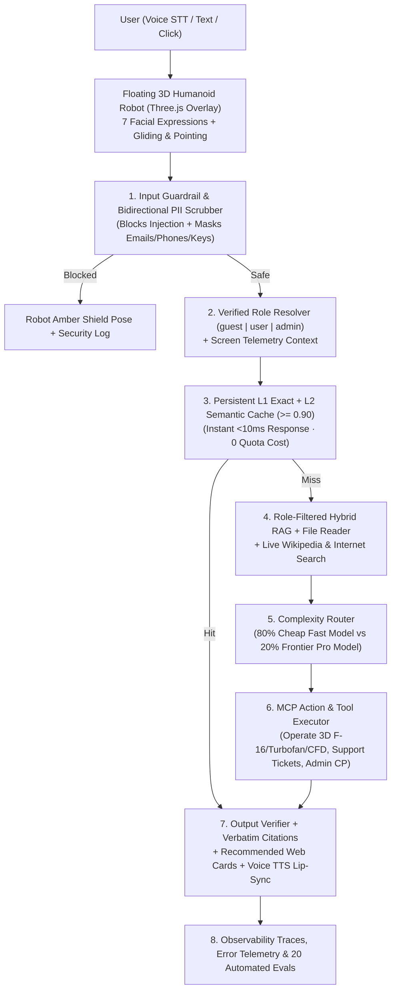

# VORTEX-GEN — Unified Team Master Plan, Architecture & 70-Point Decision Sheet

> **Purpose of This Single File**:
> This is the **one master document** for you and your team to review, discuss, and lock in every decision for **Vortex-Gen**—from fixing the current foundation (Roles, Database, Navigation, Error Boundaries, Deployment) to building the **Floating 3D Humanoid AI Robot & Enterprise RAG Platform**.
>
> **How Your Team Can Use This File**:
> - Read **Part 1** (What Needs Fixing First & Why) and **Part 2** (The 5-Phase Execution Order).
> - Go through **Part 3** (The 70 Team Questions). Each question has a **`[Recommended]`** default and a **`Team Decision:`** line where you can type your answer (or leave blank to accept the recommendation).
> - Read **Part 4** (Full Technical Architecture of the Floating 3D AI Robot, RAG, Web/Wikipedia Search, Guardrails, Cache, Model Router & Evals).
> - Once your team finishes discussing, just save this file (or tell me your overrides by number) and I will execute everything in order!

---

## PART 1 — Current Platform Audit: What We Must Fix Before Building the AI

Before attaching an AI Agent to the website, here are the **5 foundational gaps** in the current codebase that we will fix first so the AI is built on rock-solid ground:

1. **Bloated & Overlapping Roles (`accessControl.js` + `Admin.jsx`)**:
   - Currently the code mixes **7 roles** (`guest`, `student`, `event_participant`, `instructor`, `vip_professor`, `admin`, `superadmin`), **4 access tiers** (`guest_restricted`, `event_cohort`, `pro_student`, `vip_full`), and **2 tracks** (`foundation`, `engineering`).
   - Worse, `/admin` (**Host Console**) is currently visible in the top navbar to **every visitor**, and has a client-side `applyLocalFounderOverride()` button that lets any guest spoof VIP status in `localStorage`.
2. **Missing Error Boundaries**:
   - There is no React `<ErrorBoundary>` around the app or the 3D WebGL / 2D CFD canvases yet. If WebGL loses context on a lower-end laptop, the whole screen crashes instead of recovering cleanly.
3. **Navigation Bar, Panels & Missing Footer**:
   - The top navbar needs role-based filtering (only show `Admin Console` to admins), a clean `Sign In / Profile` menu (instead of the raw `DEV-XXXX` hardware fingerprint pill), collapsible 3D inspector drawers so users can view the 3D jet with zero clutter, and a **Global Footer** linking to `/privacy`, `/terms`, Support, and live System Status.
4. **Volatile Backend Storage When Supabase Is Not Connected (`backend/server.js`)**:
   - Currently, if Supabase keys aren't active in `.env`, `deviceSessions` and `eventCohorts` live in temporary Node.js RAM `Map()`s—meaning **every server restart wipes all data**. We need a **Hybrid Supabase + Persistent Local Disk Store** plus the new database tables for Support Tickets, Saved Airfoils, AI Training Docs, Cache, and Observability Logs.
5. **Deployment & Environment Readiness**:
   - We need ready-to-deploy SPA routing (`vercel.json` / `_redirects`), backend container/process configs (`Dockerfile` / `render.yaml`), and startup environment health checks.

---

## PART 2 — The 5-Phase Execution Order (Everything in Its Time)

| Phase | Scope | What Gets Built in Code | What Your Team Needs To Do |
| :--- | :--- | :--- | :--- |
| **Phase 1** | **Roles, Security & Error Cleanup** | Collapse roles to clean roles (`guest`, `user`, `admin`); remove fake local VIP override; lock `/admin` behind a real route guard; add `<AppErrorBoundary>` & `<CanvasErrorBoundary>` with 1-click 3D reload. | Confirm Role answers (#1–#10 below). |
| **Phase 2** | **Navigation, Bars, Footer & UI Polish** | Role-aware top navbar; collapsible 3D/CFD side & bottom panels; Global Footer (`/privacy`, `/terms`, status dot, support); mobile bottom-sheet responsiveness. | Confirm Navigation & Simulator answers (#11–#30 below). |
| **Phase 3** | **Database & Hybrid Persistence** | Create `supabase/migrations/009_vortex_complete.sql` (Profiles, Cohorts, Saved Airfoils, Support Tickets, AI Knowledge Docs, AI Cache & Telemetry Logs) + persistent local disk mirror (`backend/data/`) so restarts never lose data. | Confirm DB answers (#31–#40) & paste Supabase keys in `.env` when ready. |
| **Phase 4** | **Floating 3D Humanoid AI Robot + Full AI Brain** | Build the **3D Floating Humanoid Robot** (7 facial expressions, glides/points/operates UI, Voice STT+TTS) + **Self-Training Studio** + **100% Website/Policy RAG** + **Live Web & Wikipedia Search** + **Support Tickets & Admin CP Tools** + **Prompt-Injection & PII Guardrails** + **L1/L2 Semantic Cache & Cheap/Big Model Router** + **Observability & 20 Automated Evals**. | Confirm AI answers (#41–#69) & paste `GEMINI_API_KEY` / `OPENAI_API_KEY` in `backend/.env` when ready. |
| **Phase 5** | **Deployment & Final Verification** | Generate Vercel/Netlify + Render/Railway/Docker configs, run full lint + production build + all 20 automated AI Evals, and push to GitHub `main`. | Confirm Hosting target (#70) & deploy. |

---

## PART 3 — The 70 Team Discussion & Decision Questions

> **Instructions for the Team**:
> Review each question below. If your team agrees with the **`[Recommended]`** default, leave `Team Decision:` as `Default` (or check the box). If your team wants something different, write your choice on the `Team Decision:` line!

---

### SECTION 1: Roles, Permissions & User Identity (Questions 1–10)

**Q1. How many total user roles should exist in Vortex-Gen?**
- `[Recommended]`: **3 Roles Total** — `guest` (unregistered visitor), `user` (signed-in student/member or workshop participant), and `admin` (you / the core team). Delete `vip_professor`, `superadmin`, `event_participant`, and `instructor` as separate roles.
- **Team Decision**: 

**Q2. Should we delete the separate 4-tier matrix (`guest_restricted`, `event_cohort`, `pro_student`, `vip_full`) and tie permissions directly to the roles in Q1?**
- `[Recommended]`: **Yes** — tie all permissions directly to `guest`, `user`, and `admin` (or `instructor` if your team wants a 4th teacher role).
- **Team Decision**: 

**Q3. Should the 3D F-16, 3D Turbofan Engine, 3D Airliner, and 2D Smoke Wind Tunnel be 100% UNLOCKED for all `guest` visitors without locks or paywalls?**
- `[Recommended]`: **Yes, 100% unlocked for everyone** so any kid, student, or judge can explore every 3D model and wind tunnel feature immediately without hitting lock icons.
- **Team Decision**: 

**Q4. If the 3D simulators are unlocked for everyone, what should be the special benefits of signing in as a `user`?**
- `[Recommended]`: Signed-in `user`s can save custom NACA airfoils to the cloud, save quiz scores & earn a printable Flight Cadet Certificate, track their Support Tickets, and get a higher daily AI quota.
- **Team Decision**: 

**Q5. Who should be allowed to see and access `/admin` (the Host Console & AI Control Panel)?**
- `[Recommended]`: **Strictly `admin` only** (your team). Hide the `Host Console` button from the navbar for everyone else, and protect `/admin` with a real route guard.
- **Team Decision**: 

**Q6. How should your team authenticate as `admin`?**
- `[Recommended]`: Via Supabase Email + Password login (where your team emails have `role = 'admin'`) PLUS a master `ADMIN_SECRET_KEY` in `backend/.env` so your team can unlock `/admin` even during local/offline testing.
- **Team Decision**: 

**Q7. Should we remove the technical `DEV-XXXX · Guest preview` hardware fingerprint pill from the top navbar?**
- `[Recommended]`: **Yes** — keep device fingerprinting silently in the background (for rate-limiting, workshop attendance, and AI caching), and show a clean `Sign In` / User Profile button in the navbar instead.
- **Team Decision**: 

**Q8. Do you want to keep the 6-character "Workshop / Event Code" feature (like `VG-YOUTH`, `VG-UNI26`) on `/events` for live classroom sessions?**
- `[Recommended]`: **Yes** — keep it simple so your team can host live workshops and see a live participant roster & quiz leaderboard in `/admin`.
- **Team Decision**: 

**Q9. Should we remove the client-side `applyLocalFounderOverride` button that currently lets anyone in `/admin` spoof VIP status in browser `localStorage`?**
- `[Recommended]`: **Yes, delete it immediately** — all role changes must be verified by the backend.
- **Team Decision**: 

**Q10. Do you need paid Stripe subscriptions right now, or is Vortex-Gen free/educational for now?**
- `[Recommended]`: Keep Vortex-Gen **100% free/educational** for now and remove unused Stripe clutter until you decide to monetize later.
- **Team Decision**: 

---

### SECTION 2: Website Navigation, Bars, Layout & Error Handling (Questions 11–20)

**Q11. Which links should appear in the top navigation bar for normal visitors?**
- `[Recommended]`: 4 clean links: **Home** (`/`), **3D Hangar** (`/explore`), **Wind Tunnel Lab** (`/lab`), and **Workshops** (`/events`). (**Admin Console** `/admin` appears only when logged in as `admin`).
- **Team Decision**: 

**Q12. What controls should appear on the right side of the top navigation bar?**
- `[Recommended]`: (1) **`Simple Mode` / `Engineer Mode` toggle**, (2) **Light / Dark theme toggle**, and (3) **`Sign In` / Profile menu**.
- **Team Decision**: 

**Q13. Should we add a Global Footer at the bottom of scrolling pages (`/`, `/events`, `/login`, `/privacy`, `/terms`)?**
- `[Recommended]`: **Yes** — with `<VortexLogo />`, navigation links, **Privacy Policy**, **Terms of Service**, **Open Support Ticket**, and a live **System & Solver Status dot**.
- **Team Decision**: 

**Q14. Should `/explore` (3D Hangar) and `/lab` (Wind Tunnel Lab) stay locked as full-screen (`100vh`) workspaces without a scrolling footer?**
- `[Recommended]`: **Yes** — so the 3D and CFD canvases have maximum screen space.
- **Team Decision**: 

**Q15. On the Landing Page (`/`), is your team happy with the 4-section structure (Hero + 3 Mission Cards -> Live 3D/CFD Stage -> 12-Part Anatomy -> Technical Specs)?**
- `[Recommended]`: **Yes** — keep this flow and add the Global Footer at the bottom.
- **Team Decision**: 

**Q16. In `/explore` and `/lab`, should all floating inspector panels have a 1-click Minimize/Collapse (`—`) button so users can view the 3D jet with zero clutter?**
- `[Recommended]`: **Yes** — let users collapse or expand any side/bottom panel whenever they want an unobstructed 3D view.
- **Team Decision**: 

**Q17. When a user switches between `Simple Mode` (Kid-Friendly) and `Engineer Mode`, should it switch both the website text AND the AI Robot's explanation style simultaneously?**
- `[Recommended]`: **Yes** — 100% synchronized across the website and the AI Robot.
- **Team Decision**: 

**Q18. How should sidebars and control panels behave on mobile phones and tablets (`< 768px`)?**
- `[Recommended]`: Collapse sidebars into a swipeable/collapsible bottom drawer so the 3D viewport stays large and touch-friendly on top.
- **Team Decision**: 

**Q19. When any 3D WebGL canvas or React component encounters a crash or context loss, what should happen?**
- `[Recommended]`: Catch it with `<AppErrorBoundary>` / `<CanvasErrorBoundary>`, show a clean **"Reload 3D Engine"** recovery card, and automatically log the error to `/admin` Observability.
- **Team Decision**: 

**Q20. Should ambient jet/wind audio effects be muted by default so they never clash with the AI Robot's voice?**
- `[Recommended]`: **Yes**, muted by default.
- **Team Decision**: 

---

### SECTION 3: 3D Models, Hangar, Turbofan & Wind Tunnel Simulators (Questions 21–30)

**Q21. Is your team satisfied with the current 12-part 3D F-16C Fighting Falcon model, Free Orbit mode, and live 3D hover HUD?**
- `[Recommended]`: **Yes** — keep the cached 12-part lofted F-16C assembly.
- **Team Decision**: 

**Q22. Is your team satisfied with the 8-stage 3D Turbofan Engine (`Suck · Squeeze · Bang · Blow`) cutaway, hinged cowling doors, and 28s guided tour?**
- `[Recommended]`: **Yes** — keep the merged-blade cached 8-stage Turbofan.
- **Team Decision**: 

**Q23. Should the 3D Commercial Transport Airliner remain as the 3rd tab in the Hangar for the 5-subsystem curriculum & quizzes?**
- `[Recommended]`: **Yes**.
- **Team Decision**: 

**Q24. In the 2D Smoke Wind Tunnel (`NavierStokesTunnel2D.jsx`), should all 6 visualization modes (Smoke, Velocity, Vorticity, Pressure, Schlieren, Particles) and all obstacle shapes be unlocked for everyone?**
- `[Recommended]`: **Yes**.
- **Team Decision**: 

**Q25. Should 3D Watertight STL export (for 3D printing wings) and PDF Engineering Report export in `/lab` be unlocked for all users?**
- `[Recommended]`: **Yes** — unlocked for everyone.
- **Team Decision**: 

**Q26. Is the first-open preloader (`InitialPreloader.jsx` — ~1.2s on first open to compile & cache all 3D meshes, instant on repeat visits) working the way your team wants?**
- `[Recommended]`: **Yes**.
- **Team Decision**: 

**Q27. Should custom NACA airfoils designed by a user be saved to Supabase (when signed in) AND `localStorage` (when guest)?**
- `[Recommended]`: **Yes**.
- **Team Decision**: 

**Q28. Should completing the 5 Hangar subsystem quizzes unlock a printable "Vortex-Gen Flight Cadet Certificate" with the student's name?**
- `[Recommended]`: **Yes**.
- **Team Decision**: 

**Q29. Should `/lab` use the Python `NeuralFoil` solver daemon when available and automatically fall back to the built-in JS analytical solver if Python is offline?**
- `[Recommended]`: **Yes** — guarantees `/lab` never fails in any hosting environment.
- **Team Decision**: 

**Q30. Should the Floating 3D AI Robot be able to directly operate the 3D F-16, Turbofan, and Wind Tunnel live on screen for the user?**
- `[Recommended]`: **Yes!** (e.g., exploding the F-16, zooming into a specific part, opening engine cowlings, or changing NACA airfoil camber & angle of attack in the wind tunnel).
- **Team Decision**: 

---

### SECTION 4: Database, Backend & Persistence (Questions 31–40)

**Q31. Does your team already have a Supabase project created, or will you create one when we run Phase 3?**
- `[Recommended]`: We will build a single clean SQL migration (`009_vortex_complete.sql`) ready to paste into your Supabase SQL Editor whenever your keys are in `.env`.
- **Team Decision**: 

**Q32. Should the backend automatically mirror data to a persistent local disk folder (`backend/data/*.json`) whenever Supabase is not configured so server restarts NEVER wipe sessions, tickets, training data, or cache?**
- `[Recommended]`: **Yes!** Hybrid Supabase + Local Disk JSON persistence ensures zero data loss both locally and in cloud production.
- **Team Decision**: 

**Q33. Are these 7 database tables sufficient for the entire platform: `profiles`, `device_sessions`, `event_cohorts`, `saved_airfoils`, `support_tickets`, `ai_knowledge_docs`, `ai_telemetry_logs`?**
- `[Recommended]`: **Yes** — covers users, workshops, saved simulations, support tickets, custom AI training, response cache, observability logs, and evals.
- **Team Decision**: 

**Q34. Should we keep existing SQL migrations `001–008` untouched and add `009_vortex_complete.sql` cleanly on top?**
- `[Recommended]`: **Yes**.
- **Team Decision**: 

**Q35. On `/login`, should we offer (1) Quick Guest / Workshop Code entry, (2) Email + Password Account Sign-In/Sign-Up, and (3) Team Admin Passkey login?**
- `[Recommended]`: **Yes**.
- **Team Decision**: 

**Q36. When a user creates a Support Ticket through the AI Robot, how should your team manage and reply to it?**
- `[Recommended]`: Inside a live **Support Tickets Inbox** tab in `/admin` where your team can view tickets (`VG-TKT-XXXX`), change status (`open` / `in_progress` / `resolved`), and write a reply that the user can check anytime via the AI Robot.
- **Team Decision**: 

**Q37. Should your team's custom AI Training data be saved in BOTH Supabase (`ai_knowledge_docs`) AND a Git-friendly JSON file (`backend/ai/custom_knowledge.json`)?**
- `[Recommended]`: **Yes** — so your training work is always backed up in Git and in the database.
- **Team Decision**: 

**Q38. Should the AI Response Cache (for repeated questions) also be persisted to disk/Supabase so server restarts don't reset your cached answers?**
- `[Recommended]`: **Yes**.
- **Team Decision**: 

**Q39. What cache expiration (TTL) should we use?**
- `[Recommended]`: **30 days** for website/physics/history questions (auto-invalidated whenever you update training data), and **24 hours** for live internet search questions.
- **Team Decision**: 

**Q40. Should all frontend crashes (`ErrorBoundary`, `window.onerror`) and backend API errors be automatically recorded in the `/admin` Observability & Bug Log tab?**
- `[Recommended]`: **Yes**.
- **Team Decision**: 

---

### SECTION 5: The Floating 3D Humanoid AI Robot — Look, Expressions & Interaction (Questions 41–50)

**Q41. What visual design should the 3D Floating Humanoid Robot have?**
- `[Recommended]`: A sleek **3D Aerospace Co-Pilot Android** — sculpted floating upper body, articulated head, shoulders, arms & pointing hands, pearl-white & titanium armor plating, glowing electric-blue LED visor eyes, and the golden Vortex-Gen chest emblem.
- **Team Decision**: 

**Q42. Confirm: The 3D robot should float directly over the screen on a transparent pass-through layer (NOT trapped inside a rectangular chat box)?**
- `[Recommended]`: **Yes!** Only the 3D robot body and its sleek floating speech bubble are visible; clicking anywhere around the robot passes straight through to the website.
- **Team Decision**: 

**Q43. Should the 3D robot have these 7 animated facial expressions & body states?**
1. **Idle Hover**: Gentle bobbing, breathing motion, blinking LED visor eyes.
2. **Happy / Welcoming**: Curved `^ ^` visor eyes + friendly hand wave.
3. **Listening (Voice Mic On)**: Audio-reactive pulsing cyan visor + leaning in.
4. **Thinking / Searching Web**: Animated radar-scan visor + hand on chin.
5. **Speaking**: Synchronized voice LED mouth/visor pulse + expressive hand gestures.
6. **Pointing & Operating Website**: Glides across the screen toward a button or 3D jet part, points its arm/laser at it, and triggers the action for the user.
7. **Security / Guardrail Shield**: Amber visor + crossed-arm shield pose when blocking a prompt injection.
- `[Recommended]`: **Yes — include all 7 animated states.**
- **Team Decision**: 

**Q44. Where should the 3D robot hover by default, and can users move or minimize it?**
- `[Recommended]`: Floats in the **bottom-right corner** by default, glides smoothly across the screen when pointing out parts/buttons, can be **dragged anywhere** by the user, and can be minimized into a small glowing 3D helmet badge.
- **Team Decision**: 

**Q45. How should the speech bubble and input controls look when conversing with the robot?**
- `[Recommended]`: A translucent **Holographic Speech Bubble** floating beside the robot's head (with source citation pills & recommended web/Wikipedia cards) + a compact floating input pill below the robot (Mic button, Text input, Support Ticket button, and Quick Action chips). Auto-hides when idle.
- **Team Decision**: 

**Q46. When the robot "uses the website for the user", what actions should it be able to perform live on screen?**
- `[Recommended]`: Navigate to any page (`/`, `/explore`, `/lab`, `/events`), switch 3D models (`F-16`, `Turbofan`, `Airliner`, `2D Wind Tunnel`), explode/reassemble the jet or engine, focus/highlight any of the 12 F-16 parts or 8 Turbofan stages, open the engine cowling doors, start the 28s engine tour, adjust Wind Tunnel NACA airfoil shape & angle of attack, and toggle `Simple` vs `Engineer` mode.
- **Team Decision**: 

**Q47. Should the robot give a brief 5-second wave and 1-line greeting bubble on a user's first visit?**
- `[Recommended]`: **Yes** — waves hello (*"Hi! I'm Vortex-AI. Click me or tap the mic if you want me to fly, explain any part, or search aviation facts!"*) and auto-hides after 5 seconds.
- **Team Decision**: 

**Q48. How should Voice Mode (Speech-to-Text & Text-to-Speech) work?**
- `[Recommended]`: Supports both **Push-to-Talk** (tap mic icon) and **Hands-Free Continuous Voice Mode** (speak naturally -> robot transcribes -> robot answers out loud with natural cockpit TTS & visor lip-sync -> listens for follow-up), plus an instant **Mute / Stop Speaking** button.
- **Team Decision**: 

**Q49. How should the robot's personality & voice tone adapt?**
- `[Recommended]`: In `Simple Mode`, speaks like an encouraging, fun NASA/Fighter Pilot mentor that even a 7-year-old can understand; in `Engineer Mode`, speaks like a sharp Lead Aerospace Engineer with exact equations and telemetry.
- **Team Decision**: 

**Q50. What official name should the robot have?**
- `[Recommended]`: **Vortex-AI** (or write your team's favorite name below).
- **Team Decision**: 

---

### SECTION 6: AI Brain — Self-Training Studio, RAG, Live Internet/Wikipedia & Policies (Questions 51–60)

**Q51. How should the "Train-It-Yourself Studio" in `/admin` work for your team?**
- `[Recommended]`: A visual studio in `/admin` where your team can:
  1. Edit the **Master System Prompt & Brand Identity Rules**.
  2. Add/Edit **Custom Q&A Pairs & Official Facts**.
  3. Upload/Paste **Knowledge Files** (`.md`, `.txt`, `.json`, `.csv`, `.pdf` text) with role tags (`public` vs `admin_only`).
  4. Click **"Save & Re-Index Now"** to hot-reload the RAG brain and clear outdated cache in 1 second.
- **Team Decision**: 

**Q52. Confirm: Before your team even adds custom files, the AI will already know 100% of Vortex-Gen out of the box?**
- `[Recommended]`: **Yes** — pre-indexed with all 12 F-16 parts, 8 Turbofan stages, 5 Airliner subsystems & quizzes, Wind Tunnel CFD controls, aerodynamics equations, workshop cohorts, Privacy Policy, and Terms of Service.
- **Team Decision**: 

**Q53. How should Live Internet & Wikipedia Search work (e.g., *"What are the best flight schools?"*, *"Who are the Wright brothers?"*)?**
- `[Recommended]`: Built-in **Live Web + Wikipedia Search Pipeline**:
  - Automatically queries the **Wikipedia REST API** + **Live Web Search** (Google Gemini Search Grounding / DuckDuckGo / Tavily) whenever a user asks about real-world flight schools, aviation history (Wright brothers, SR-71, Apollo, airlines), or external aerospace topics.
  - Synthesizes a verified answer and displays **Clickable Recommended Wikipedia & Web Article Cards** (with thumbnail/title/summary/URL) right inside the speech bubble.
- **Team Decision**: 

**Q54. What are the exact topic boundaries (what the AI answers vs. what it refuses)?**
- `[Recommended]`:
  - **Answers**: Everything about Vortex-Gen, airplanes, jet engines, physics, aerodynamics, flight schools, aviation history, pilots, STEM careers, platform policies, and user support.
  - **Refuses**: Unrelated off-topic chat (politics, medical advice, writing unrelated software, adult content, or prompt-injection attacks), politely steering the user back to aviation & Vortex-Gen.
- **Team Decision**: 

**Q55. How strictly must the AI handle Policy & Legal questions (Privacy Policy, Terms of Service, rules)?**
- `[Recommended]`: **Zero hallucination (`temperature = 0.0`)** — it must quote verbatim clauses from `LegalPages.jsx` or your uploaded policy documents with a `[Policy Citation: Section X]` badge, and never invent a policy that doesn't exist.
- **Team Decision**: 

**Q56. Should every AI answer display clickable Source Badges (`[3D Hangar Spec]`, `[Policy §]`, `[Wikipedia]`, `[Live Web]`, `[Team Trained]`)?**
- `[Recommended]`: **Yes**.
- **Team Decision**: 

**Q57. Should users or admins be able to attach/drop a file (`.txt`, `.md`, `.csv`, `.dat` airfoil coordinates) into the AI chat for analysis?**
- `[Recommended]`: **Yes**.
- **Team Decision**: 

**Q58. Should the AI automatically see the user's live screen state on every message (current route, active 3D model, selected F-16/Turbofan part, Wind Tunnel AoA/speed, and `Simple`/`Engineer` mode)?**
- `[Recommended]`: **Yes** — so if a user selects the `AN/APG-68 Radar` and asks *"How far can this see?"*, the robot immediately knows which part they mean!
- **Team Decision**: 

**Q59. Which languages should the AI understand and reply in?**
- `[Recommended]`: Primarily **English**, and automatically reply in **Arabic** (or any language the user speaks/types in) when addressed in that language.
- **Team Decision**: 

**Q60. When your team updates a rule or document in the `/admin` Training Studio, should it automatically invalidate old cached answers so the new answer goes live immediately?**
- `[Recommended]`: **Yes**.
- **Team Decision**: 

---

### SECTION 7: Support Tickets, CP Tools, Guardrails, Quota Cache, Model Router & Evals (Questions 61–70)

**Q61. How should the AI's Support & Ticketing Mode work when a user has a problem or concern?**
- `[Recommended]`: The user can say *"I have an issue"* (or click the **Support Ticket** pill). The robot collects their issue + category (`Bug`, `Account/Access`, `Workshop`, `General`), creates a tracked ticket (`VG-TKT-XXXX`), masks PII in logs, and lets them check status anytime.
- **Team Decision**: 

**Q62. Which Control Panel (CP) / Admin tools should the AI execute when a logged-in `admin` gives it a command?**
- `[Recommended]`: Admins can tell the robot by voice or text:
  - *"Create workshop code VG-SUMMER26"* (`admin_create_cohort`)
  - *"List open support tickets"* / *"Resolve ticket VG-TKT-1004"* (`admin_manage_tickets`)
  - *"Add this Q&A rule to your training memory..."* (`admin_train_knowledge`)
  - *"Run the 20 AI Evals"* (`admin_run_evals`)
  - *"Show today's error logs and cache quota savings"* (`admin_system_diagnostics`)
- **Team Decision**: 

**Q63. Confirm RBAC Security: `guest` and `user` roles must NEVER see `admin_only` training docs, other users' tickets, system prompts, or Admin CP tools?**
- `[Recommended]`: **Yes — strictly enforced on the backend before RAG retrieval and before tool execution.**
- **Team Decision**: 

**Q64. Confirm Guardrails: Every message passes through (1) Prompt-Injection Firewall, (2) Bidirectional PII Scrubber (`[REDACTED_EMAIL]`, `[REDACTED_PHONE]`, `[REDACTED_KEY]`), and (3) Output Leak Verifier?**
- `[Recommended]`: **Yes**.
- **Team Decision**: 

**Q65. Which LLM API Provider(s) does your team want to use for the Cheap Model vs. Big Model router?**
- `[Recommended]`: Unified multi-provider router supporting **Google Gemini (`GEMINI_API_KEY`)**, **OpenAI (`OPENAI_API_KEY`)**, and **Groq / OpenRouter** — PLUS a built-in **Zero-Key Local RAG + Wikipedia/Web Engine** so the entire AI works 100% out-of-the-box even before you paste an API key!
- **Team Decision**: 

**Q66. Confirm the Cheap vs. Big Model Routing & Cache Strategy:**
- `[Recommended]`:
  1. **Step 1 — L1 Exact + L2 Semantic Cache ($\ge 0.90$ similarity)**: Repeated or similar questions return in `< 10ms` at **$0 token cost**.
  2. **Step 2 — Small Cheap/Fast Model (`gemini-2.5-flash-lite` / `gpt-4o-mini`)**: Handles ~80% of uncached queries (navigation, simple explanations, FAQ, ticket intake).
  3. **Step 3 — Frontier Big Model (`gemini-2.5-pro` / `gpt-4o`)**: Used **only** for complex multi-variable aerodynamic derivations or multi-tool reasoning (~20%).
- **Team Decision**: 

**Q67. What per-user rate limit should protect your API quota from bots or abuse?**
- `[Recommended]`: **20 uncached AI generations per minute** (150/day) per guest device; cached answers are unlimited since they use 0 quota.
- **Team Decision**: 

**Q68. What should appear in the `/admin` Observability & Bug Telemetry Dashboard?**
- `[Recommended]`: Total requests, **Cache Hit % & Tokens Saved**, Cheap vs. Big Model split, Average Latency (ms), Blocked Prompt Injections, Masked PII count, Frontend/Backend Error Logs, and searchable Conversation Traces.
- **Team Decision**: 

**Q69. Confirm the Automated Evaluation Suite ("Evals"):**
- `[Recommended]`: A 1-click **"Run 20 Golden Evals"** button in `/admin` (plus `npm run eval:ai` in terminal) that tests Website RAG accuracy, Wikipedia/Web recommendations, Policy verbatim citations, RBAC isolation, Prompt-Injection defense, PII masking, and Cache/Model routing after every change.
- **Team Decision**: 

**Q70. Where does your team plan to deploy the Frontend, Backend, and Database?**
- `[Recommended]`: **Frontend**: Vercel or Netlify (`vercel.json` included); **Backend**: Render, Railway, or Docker (`Dockerfile` + `render.yaml` included); **Database**: Supabase Cloud (+ automatic local disk fallback).
- **Team Decision**: 

---

## PART 4 — Technical Architecture Reference (For Your Engineering Team)

